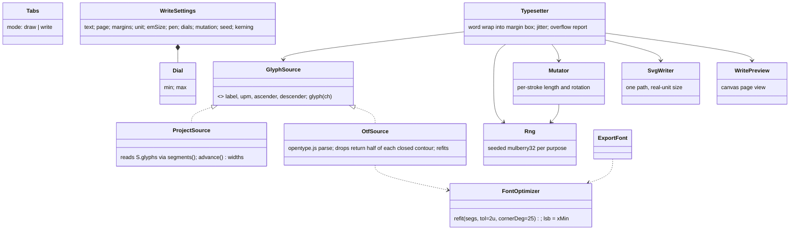
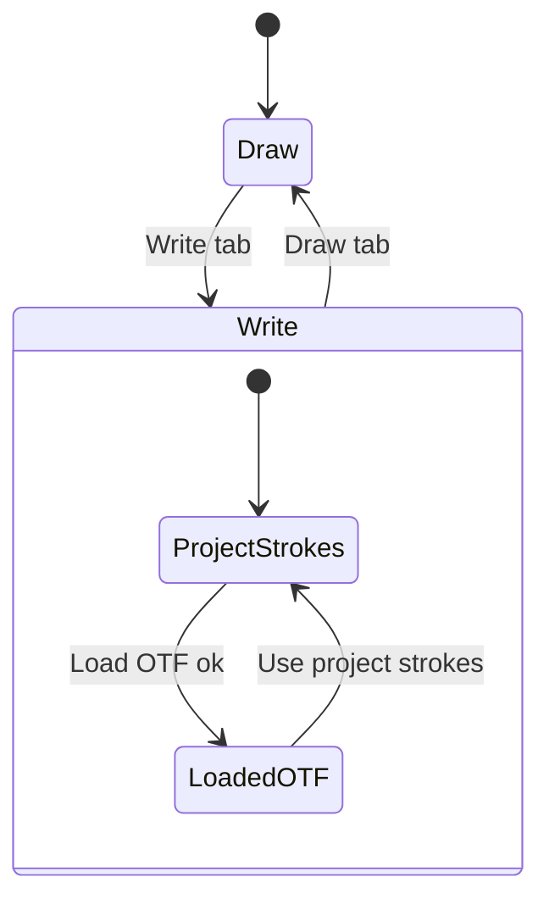

<!-- Created by Claude (claude-opus-5-5) -->
<!-- Date: 2026-11-09 -->

# Plan: Stroke Plotter Write Tab

| Field | Value |
|---|---|
| Status | Implemented |
| Created | 2026-11-09 |
| Updated | 2026-11-09 |
| Proficiency | 6/10 |
| Engine | Plain HTML / JavaScript (single `index.html`, opentype.js 1.3.4) |
| Revisions | 1 (latest: U-001) |
| Summary | Adds a Write tab that typesets a body of text with the single-line font onto a page with margins, with randomised spacing and letter shapes, and brings the Python FontTool's OTF optimization and single-path SVG export into Stroke Plotter. |

## Revision Log

| ID | Date | Type | Change |
|---|---|---|---|
| U-001 | 2026-11-09 | Update | Text alone in a wider left rail with Letters from and Page moved right; dials become min/max sliders; kerning becomes pair rows with sliders; layout paginates up to 50 pages with one SVG per page; export asks for a file name seeded from the text. |

---

## Overview

Stroke Plotter currently draws single-stroke glyphs and exports a short text SVG or an installable OTF. The Python tool in `C:/Users/alex_/Desktop/FontTool/` (`text_to_svg.py`, `HANDOFF.md`) added three things on top: an optimized OTF (curve refit at 2 font units, corners sharper than 25 degrees kept, left side bearings fixed), pair kerning plus letter spacing, and an SVG whose strokes are all subpaths of one `<path>` so Cricut Design Space imports it as a single layer. This plan folds all of that into the web app and adds a Write tab: a page of chosen size and margins, word-wrapped text, spacing dials that each carry a random range, and a mutation dial that randomises stroke length and direction per letter instance. Randomness is seeded so the preview and the export match and a layout can be reproduced.

## Architecture



## Key Flows

### Render and export

```mermaid
sequenceDiagram
    participant UI as Write rail input
    participant WC as writeChanged()
    participant GS as GlyphSource (active)
    participant TS as layoutText()
    participant MU as mutateStrokes()
    participant PV as drawWritePreview()
    UI->>WC: input event (text, page, dial, seed)
    WC->>WC: save W settings, persist(), schedule rAF
    WC->>TS: layoutText(W, GS)
    loop each word / letter
        TS->>GS: glyph(ch) gives adv, strokes (em, y down)
        TS->>TS: spacing = min + rng(seed,'letter',i) x (max - min); kerning
        TS->>MU: mutateStrokes(strokes, mutation, rng(seed,'shape',i))
        TS->>TS: wrap at right margin; new page at bottom margin (cap 50)
    end
    TS-->>WC: pages, overflowAt, missing
    WC->>PV: draw page, margin box, strokes
    Note over UI,PV: Export SVG asks for a file name, calls layoutText() with the same inputs, then writeSVG() per page, so it matches the preview
```

### OTF import and font export

```mermaid
sequenceDiagram
    participant U as User
    participant OS as OtfSource
    participant FO as FontOptimizer
    U->>OS: Load single-line OTF
    OS->>OS: opentype.parse(buffer)
    loop each glyph contour
        OS->>OS: second half matches reversed first half? keep first half open : keep closed
        OS->>FO: refitStroke(segs, tol, 25 deg)
    end
    OS-->>U: source = file name; preview re-renders
    U->>FO: Export font (.otf) from Draw tab
    FO->>FO: project strokes, refit, forward plus return contour; leftSideBearing = xMin
```

### Tabs and glyph source



## Components

Shared shapes: `Seg = [p0, c1, c2, p3]` with points `[x, y]` in em units, y down (the shape `segments()` returns today). `Stroke = { segs, closed }`. `Glyph = { adv, strokes }` with `adv` in em.

### Tabs

Responsibility: switch the page between Draw (current editor) and Write.
Owns: `S.mode`.
Pattern: none.

Stub:
```js
function setMode(mode) {} // 'draw' | 'write': toggles the rail card groups and which canvas draw function runs; saved in S.mode
```

### GlyphSource (ProjectSource, OtfSource)

Responsibility: give the typesetter a glyph's advance and open strokes, whatever their origin.
Owns: the loaded OTF's parsed glyphs (in memory only, never persisted).
Pattern: a two-implementation interface, so the typesetter never branches on the source.

Stub:
```js
function projectSource() {}            // wraps S.glyphs via segments() and advance(); ascender and descender from fontBoundingBox, as buildFont() does
async function loadOtfSource(file) {}  // opentype.parse; L and Q commands converted to cubics; divide by upm and flip y; each contour through stripReturnTrace then refitStroke; rejects on parse failure
function stripReturnTrace(segs, tolEm) {} // second half matches the reversed first half within tol: { segs: first half, closed: false }; otherwise { segs, closed: true }
```

### FontOptimizer

Responsibility: reduce node count without visible change, and write correct side bearings.
Owns: `S.fontTol` (font units, default 2, 0 turns refitting off).
Pattern: none.

Stub:
```js
function refitStroke(segs, tolEm, cornerDeg = 25) {} // sample to a polyline, split where the turn is sharper than cornerDeg, fit each run within tolEm; tolEm 0 returns segs unchanged
function fitCubics(pts, tolEm) {}      // Schneider least-squares cubic fit with recursive split at the worst point
// buildFont(): each stroke goes through refitStroke(S.fontTol / 1000) before the forward plus return contour; each glyph gets leftSideBearing = path xMin
```

### Rng

Responsibility: reproducible randomness, one independent stream per purpose so changing one dial does not reshuffle the others.
Owns: nothing; seed lives in `W.seed`.

Stub:
```js
function rng(seed, purpose, index) {} // hash(seed, purpose, index) seeds mulberry32; returns () => [0, 1). Purposes: 'letter', 'word', 'line', 'shape'
function jitter(dial, r) {}           // dial.min + r * (dial.max - dial.min)
```

### Mutator

Responsibility: vary each letter instance so repeated letters differ.
Owns: nothing.

Stub:
```js
function mutateStrokes(strokes, amount, rand) {} // per open stroke: trim or extend each end by up to 15% of its length * amount (de Casteljau split to trim, tangent extension to extend); every stroke rotates about its bbox centre by up to 8 deg * amount; amount 0 returns input untouched
```

### WriteSettings and Typesetter

Responsibility: hold the Write tab's inputs and lay text out on the page.
Owns: `S.write` (autosaved and included in Save project).

Stub:
```js
const W = { text, unit: 'in', pageW, pageH, margin: { t, r, b, l }, emSize, pen,
            letter: { min, max }, word: { min, max }, line: { min: 1, max: 1 },
            mutation: 0, seed: 1, kerning: [[pair, units]] };
function parseKerning(str) {}  // old text form, "To -60, AV -80" gives { To: -60, AV: -80 }; only used to convert older saves
function layoutText(W, src) {} // { pages: [[{ x, y, strokes }]], overflowAt: charIndex | -1, missing: string[] }; text past the bottom margin starts a new page, up to MAX_PAGES (50)
                               // greedy word wrap inside the margin box, manual line breaks kept; words wider than the box break by letter;
                               // first baseline = top margin + ascender; line advance = (ascender - descender) * jitter(line)
function convertUnits(to) {}   // rescales page, margins, emSize and pen so the physical size stays the same
```

Letter and word spacing are in font units (1000 = em), as in `text_to_svg.py`. Word spacing adds to the space glyph's advance. Kerning is added before each character, keyed by the previous and current character.

### SvgWriter

Responsibility: write the same SVG shape as `text_to_svg.py`.

Stub:
```js
function writeSVG(placed, W) {} // one page; one <path>: every stroke a subpath, fill none, stroke #000, round caps and joins; width and height in W.unit; viewBox 0 0 pageW pageH in page units
```

### WritePreview

Responsibility: show the page as it will export.

Stub:
```js
function drawWritePreview(layout, W) {} // fit the page to the canvas; page rect, dashed margin box, strokes in --stroke at pen width; shows layout.pages[wPage] with a page switcher; tint the bottom margin on the last page when text overflows
function writeChanged(save = true) {}   // rAF-batched: layoutText, drawWritePreview, warnings, persist()
```

## Patterns Applied

| Pattern | Where | Why |
|---|---|---|
| Interface with two implementations | `projectSource` / `loadOtfSource` | typesetter stays source-agnostic |
| Seeded per-purpose RNG streams | `rng(seed, purpose, index)` | preview equals export; dials independent |

## Open Questions

- [ ] Step 1 picks the Write tab layout and palette.
- [ ] Single-path SVG import into Design Space is still unconfirmed (carried over from the handoff).

## Steps

Execution: Implement the steps in `#` order in one session, started on opus.

| # | Step | Files | Depends on |
|---|---|---|---|
| 1 | Write tab layout pick: 3 grayscale mockups, then palette (P1 warm paper plus 2 alternatives) | none | none |
| 2 | Optimizer: `refitStroke`, `fitCubics`; `buildFont` refit plus `leftSideBearing`; Refit tolerance slider | `apps/stroke-plotter/index.html` | none |
| 3 | `rng`, `jitter`, `mutateStrokes` | `apps/stroke-plotter/index.html` | none |
| 4 | `projectSource`, `loadOtfSource`, `stripReturnTrace` | `apps/stroke-plotter/index.html` | 2 |
| 5 | `parseKerning`, `layoutText`, `writeSVG` | `apps/stroke-plotter/index.html` | 3, 4 |
| 6 | Write tab UI: `setMode`, cards, `drawWritePreview`, `convertUnits`, persistence, project save and open; remove the old Write text card | `apps/stroke-plotter/index.html` | 1, 5 |
| 7 | README sections; `node scripts/sync-logo.mjs --check`; browser check of preview against export, single path, seed reproducibility | `apps/stroke-plotter/README.md`, `apps/stroke-plotter/index.html` | 6 |

## Implementation Notes

- Margins wider than the page are clamped so the text box stays at least one em wide, with a warning.
- A missing character advances by the space width and is listed under "Not in font", as in the Python tool.
- An OTF whose contours carry no return traces is an outline font; it loads with a toast saying the pen will draw both edges.
- Negative letter spacing is allowed; each advance is floored at 0 so letters never move backwards.
- Empty text exports a blank page SVG.
- Export prompts for a file name, suggesting the first four words of the text with only a-z, 0-9, _ and - kept; several pages save as name-p1.svg, name-p2.svg, spaced 250 ms apart so the browser keeps every download.
- Dial min and max thumbs push each other, so min never exceeds max.
- Check whether opentype.js 1.3.4 writes `hmtx` left side bearings from `glyph.leftSideBearing` or recomputes them; set it explicitly either way and verify by re-parsing the exported buffer.
- Page presets: Letter (8.5 x 11 in), A4 (210 x 297 mm), 4 x 6 card, Custom. Default unit is inches.
- The loaded OTF is not persisted; after a reload the Write tab falls back to project strokes.
