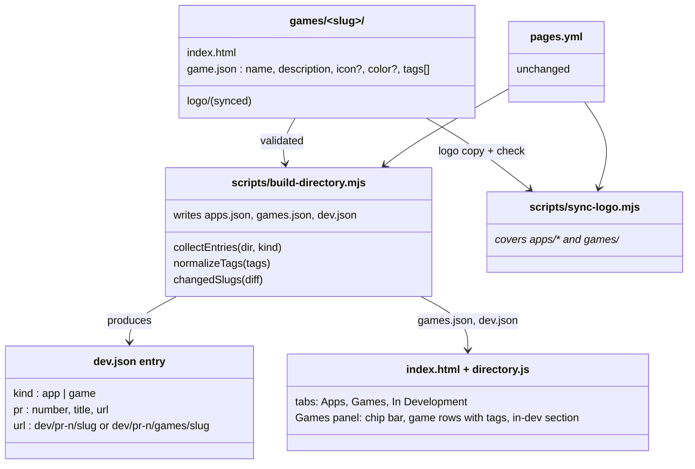
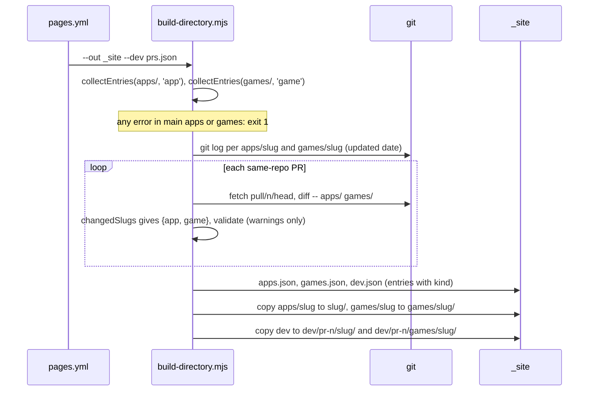
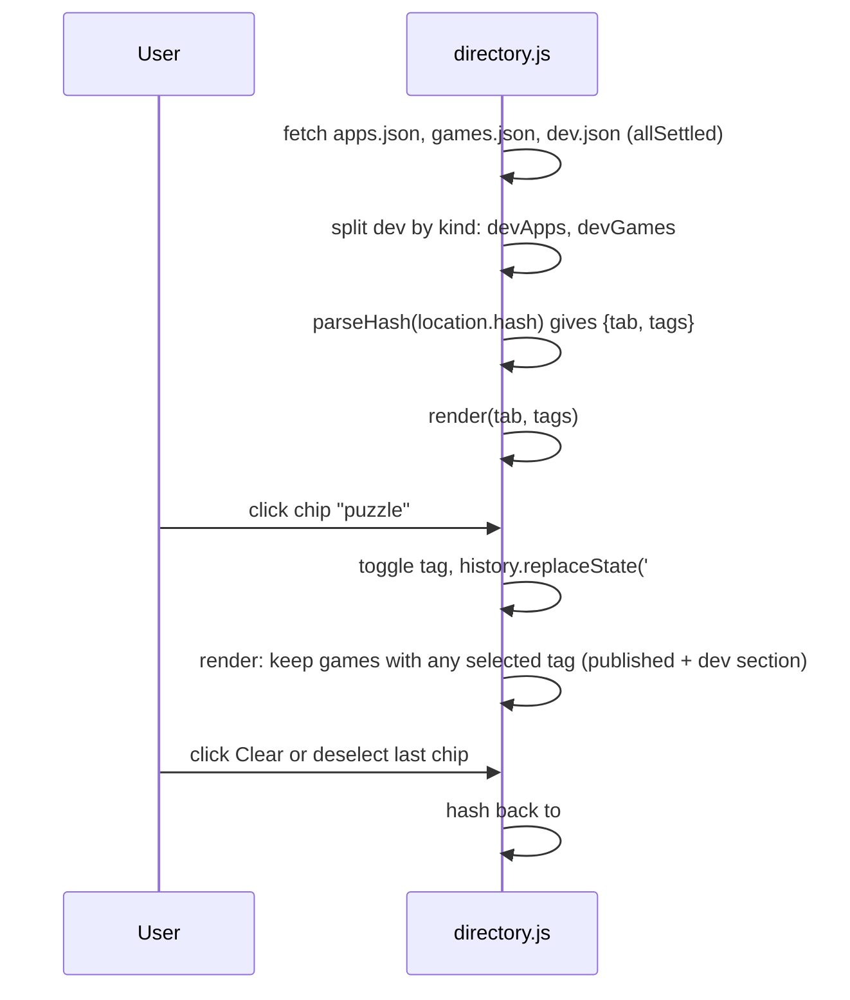
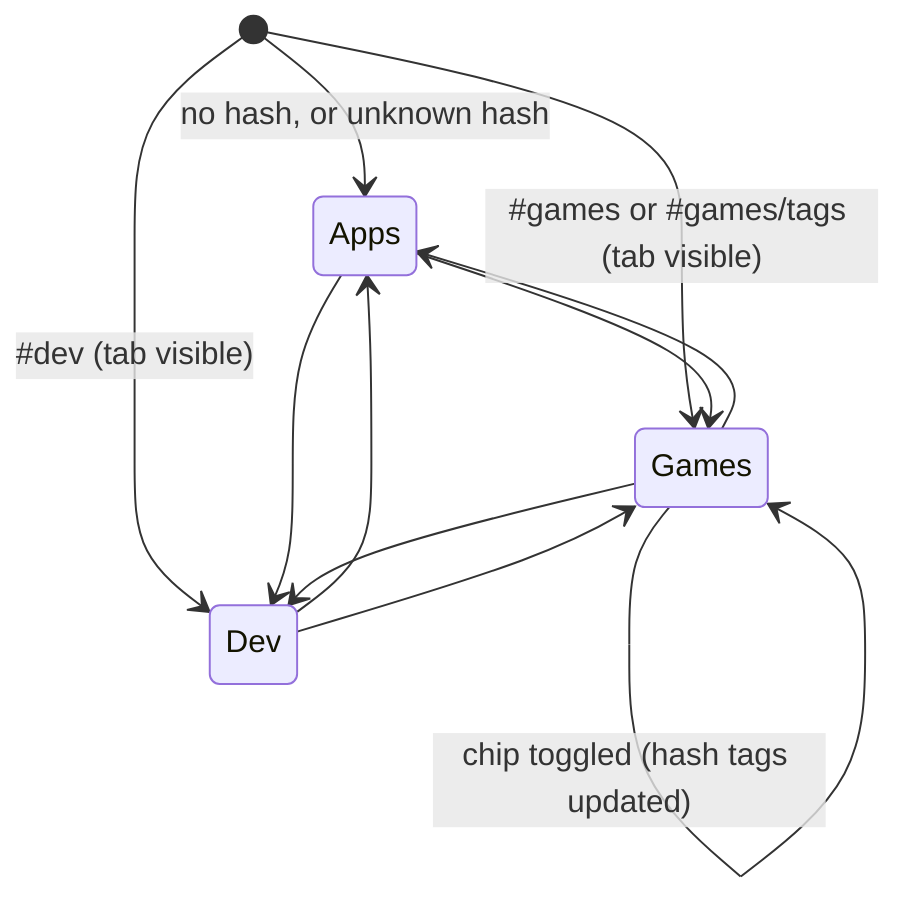

# Plan: Games Tab

Created by Claude (claude-opus-5-5), 2026-10-19

| Field | Value |
|---|---|
| Status | Implemented |
| Created | 2026-10-19 |
| Updated | 2026-10-19 |
| Proficiency | 6/10 |
| Engine | Node 22 build scripts, plain HTML/CSS/JS directory page |
| Revisions | 0 (latest: none) |
| Summary | Adds a `games/` folder built like `apps/`, a Games tab on the Pages directory, and filterable tag chips per game. |

## Revision Log

| ID | Date | Type | Change |
|---|---|---|---|
| (empty until first amendment) |

---

## Overview

Games live in `games/<slug>/` beside `apps/`, each with a `game.json` that matches `app.json` plus a required `tags` array. The build validates both folders with one shared validator, publishes games at `games/<slug>/`, writes `games.json`, and gives PR previews of games their own path. The directory page gains a Games tab with a multi-select chip bar (OR match) whose selection lives in the URL hash, game rows that show their tags, and an "In development" section for games in open PRs. The In Development tab stays apps only.

## Architecture



## Key Flows

### Build



### Page load and chip filtering



### Tab state



## Components

### games/&lt;slug&gt;/

Responsibility: one game's files, served at `games/<slug>/`.
Owns: `index.html`, `game.json`, `logo/` (synced copy).

`game.json`:

```json
{
  "name": "Block Drop",
  "description": "Falling-block puzzle in the browser.",
  "icon": "book",
  "color": "blue",
  "tags": ["puzzle", "arcade"]
}
```

`name` and `description` are required, `icon` and `color` follow the `app.json` rules, `tags` is a required non-empty array of strings.

### scripts/build-directory.mjs

Responsibility: validate apps and games, assemble the Pages site.
Owns: `KINDS` table, tag normalization, `apps.json`, `games.json`, `dev.json`.

Methods:
- `normalizeTags(tags)` -> `{ tags, error }`, lowercase, trim, dedupe, sort; error when not an array, empty, or a tag fails `SLUG`
- `collectEntries(dir, kind)` -> `{ entries, errors }`, replaces `collectApps`
- `gitUpdated(relPath, cwd)` -> ISO string or null
- `buildIndex(entries, getUpdated)` -> sorted entries with `url`
- `changedSlugs(nameStatus)` -> `{ app, game }`
- `buildDevIndex(prs, entriesByPr)` -> dev entries with `kind` and `url`
- `collectDev(prs, run, workDir)` -> `{ entries, warnings }`
- `assembleSite(rootDir, outDir, { apps, games }, devEntries, workDir)`

Stub:

```js
export const KINDS = {
  app:  { dir: 'apps',  meta: 'app.json',  reserved: ['dev', 'games'] },
  game: { dir: 'games', meta: 'game.json', reserved: [] },
};
// Lowercase, trim, dedupe, sort. Error when not an array, empty, or a tag fails SLUG.
export function normalizeTags(tags) {}            // -> { tags: string[], error: string | null }
// Same checks as collectApps; games also require tags; reserved slugs fail. Entries gain `kind` (+ `tags` for games).
export function collectEntries(dir, kind) {}       // -> { entries, errors }, errors prefixed "<dir>/<slug>: "
export function gitUpdated(relPath, cwd) {}        // relPath "apps/x" or "games/x"
// url: app "<slug>/", game "games/<slug>/". Same sort as today.
export function buildIndex(entries, getUpdated) {} // getUpdated(entry)
export function changedSlugs(nameStatus) {}        // -> { app: string[], game: string[] }
// url: "dev/pr-<n>/<slug>/" or "dev/pr-<n>/games/<slug>/"
export function buildDevIndex(prs, entriesByPr) {}
// Diffs and extracts apps/ and games/ into <workDir>/pr-<n>/{apps,games}/<slug>
export function collectDev(prs, run, workDir) {}
// Writes apps.json, games.json, dev.json; copies apps to <slug>/, games to games/<slug>/
export function assembleSite(rootDir, outDir, { apps, games }, devEntries, workDir) {}
```

### scripts/sync-logo.mjs

Responsibility: copy `assets/logo/` into every app and game, and check pages for the two logo lines.
Owns: nothing new.

Methods:
- `syncLogo(rootDir, { check })` -> problems, loops over `['apps', 'games']`, skips a missing folder, prefixes messages with the folder name

### directory.js, index.html, directory.css

Responsibility: render three tabs, the chip bar, and the filtered game lists.
Owns: tab and tag state, derived from `location.hash`.

Methods:
- `parseHash(hash)` -> `{ tab, tags }`
- `formatHash(tab, tags)` -> string
- `allTags(entries)` -> sorted unique tags
- `filterByTags(entries, tags)` -> entries matching any tag; empty tags returns all
- `renderChips(tags, selected, doc)` -> chip bar element
- `renderList(entries, doc, emptyText)` -> list element; game rows show tag chips
- `renderGames(games, devGames, selected, doc)` -> Games panel fragment

Stub:

```js
export function parseHash(hash) {}                 // "#games/a,b" -> { tab: 'games', tags: ['a','b'] }; unknown -> apps
export function formatHash(tab, tags) {}           // inverse; apps -> ""
export function allTags(entries) {}                // sorted unique tags
export function filterByTags(entries, tags) {}     // OR match; empty tags -> all entries
export function renderChips(tags, selected, doc) {} // buttons with data-tag + aria-pressed, plus Clear when any selected
export function renderList(entries, doc, emptyText) {} // game rows also show display-only tag chips
export function renderGames(games, devGames, selected, doc) {} // chips + list + "In development" section
```

`index.html` adds a `tab-games` button between Apps and In Development. `directory.css` adds `.chips`, `.chip`, `.chip[aria-pressed="true"]`, `.tag`, `.section-heading` from existing tokens.

## Patterns Applied

| Pattern | Where | Why |
|---|---|---|
| none | | One `kind`-parameterized validator covers the only coupling point. |

## Open Questions

- [ ] None. The Games tab stays hidden until the first game is added.

## Steps

Execution: Implement the steps in `#` order in one session, started on opus.

| # | Step | Files | Depends on |
|---|---|---|---|
| 1 | Generalize the build to apps and games (`KINDS`, `normalizeTags`, `collectEntries`, `games.json`, dev `kind`), with tests | `scripts/build-directory.mjs`, `scripts/build-directory.test.mjs`, `games/.gitkeep` | none |
| 2 | Extend logo sync to `games/`, with tests | `scripts/sync-logo.mjs`, `scripts/sync-logo.test.mjs` | none |
| 3 | Games tab, chips, hash routing, styles, with tests | `index.html`, `directory.js`, `directory.css`, `scripts/directory.test.mjs` | 1 |
| 4 | Update docs for `games/` | `README.md`, `CLAUDE.md` | 1, 2 |
| 5 | Verify: tests, a local build with a throwaway sample game, browser check | none | 1 to 4 |

## Implementation Notes

- Tab visibility: Games shows when there is at least one published or dev game; In Development shows only for dev apps; the tab bar hides when Apps is the only tab. A hash naming a hidden tab falls back to Apps.
- Chips come from published and dev game tags together. The filter applies to both the published list and the In development section. Tags in the hash that no game has are dropped.
- Hash format: `#games` or `#games/<tag>,<tag>`. Encode and decode each tag with `encodeURIComponent`, although `SLUG` makes that a no-op today.
- Row tag chips are display-only spans, since a button inside the row link is invalid HTML.
- If `games.json` fails to load, the Games tab shows dev games only, or stays hidden if there are none. Apps behave as today.
- Filtered-empty message: "No games match these tags." Count line: "1 game" or "<n> games".
- `games/` needs a `.gitkeep` so `collectEntries` and `syncLogo` find the folder on a fresh checkout; both still skip a missing folder.
- The workflow needs no change: `node --test scripts/*.test.mjs`, `build-directory.mjs`, and `sync-logo.mjs --check` already run and will cover games.
