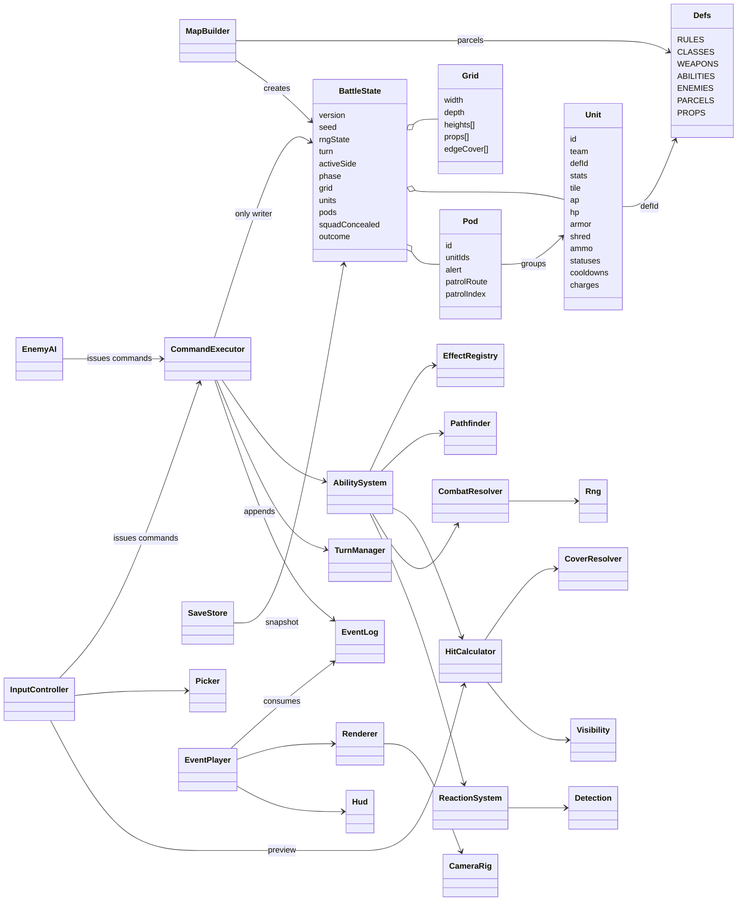
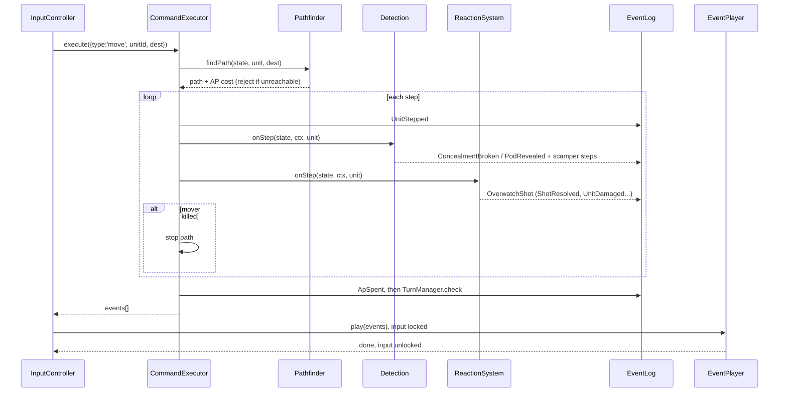
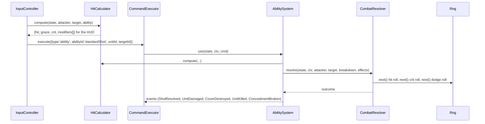
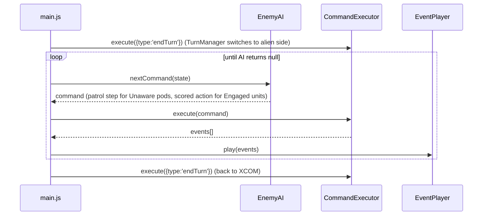
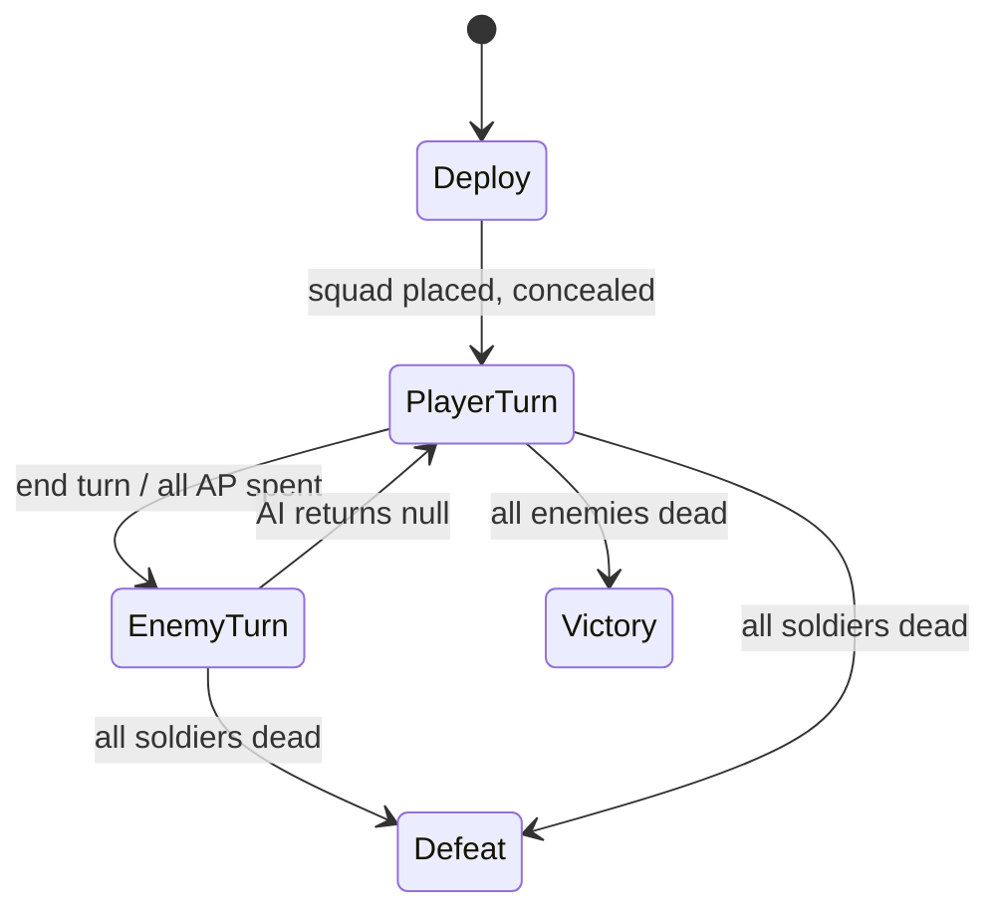
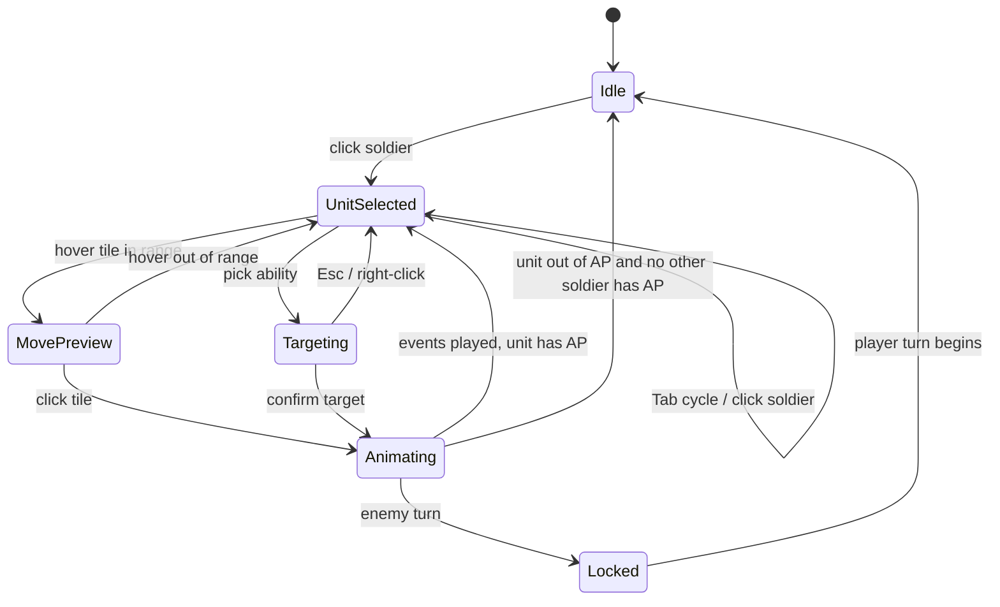
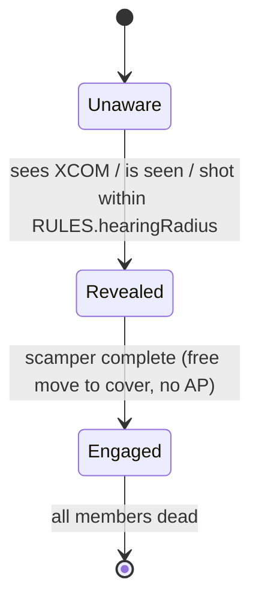

# Plan: Vigil Tactical Layer

| Field | Value |
|---|---|
| Status | In Progress |
| Created | 2026-10-21 |
| Updated | 2026-10-21 |
| Proficiency | 5-7/10 |
| Engine | JavaScript (ES modules, no build step) + three.js, static page in `games/vigil/` |
| Revisions | 5 (latest: U-005) |
| Summary | XCOM 2 style turn-based squad combat in the browser: heightmap grid, cover, hit chances, overwatch, concealment and pods, four classes, destructible cover, one Sweep mission. |

## Revision Log

| ID | Date | Type | Change |
|---|---|---|---|
| U-005 | 2026-10-21 | Update | Step 4 data: abilities gain `name` and `description` for the rail list; WEAPONS adds melee `sword` and `stunBaton` (no range table); `ammo: null` means unlimited (pistol, melee); effect fields documented in AbilitySystem. |
| U-004 | 2026-10-21 | Fix | Test command is `node --test "games/vigil/tests/*.test.mjs"`: Node 25 treats a bare directory argument as a module and fails. |
| U-003 | 2026-10-21 | Update | Layout gate (step 2): picked C Tactical Rail from docs/mockups/layout.html. v1 is desktop only (mouse and keyboard); touch Open Question closed. UI Reference records where each piece sits in the rail layout. |
| U-002 | 2026-10-21 | Update | Added UI Reference (R1 to R15) from the user's XCOM 2 screenshot. Hud gains showSquad, showObjective, updateUnitBars. Move range draws as perimeter outlines. Step 2 prompt cites the reference. |
| U-001 | 2026-10-21 | Update | Palette gate (step 1): picked A Command Cyan from docs/mockups/palette.html. Tokens: background #0B1118, surface #121C26, surface-raised #1B2834, text #E6EEF4, text-muted #8A9BAA, accent #3FD0E8, xcom-team #4AA8FF, alien-team #E5484D, move-blue #2F8CFF, move-yellow #F2C94C, danger/detection-red #FF3B3B, half-cover #6E9BB8, full-cover #43C4F0, crit #FFB13B. |

---

## Overview

Vigil is the tactical layer of an XCOM 2 inspired game, built as a static game in the `web-apps` repo under `games/vigil/`. A squad of four soldiers (Ranger, Sharpshooter, Grenadier, Specialist) starts concealed on a map assembled from hand-authored parcels, scouts toward pods of enemies, and fights a Sweep mission (kill every enemy) using two-action turns, half and full cover, a shared hit-chance model, overwatch, class abilities and explosives that destroy cover. The code splits into a pure simulation (`js/sim/`, no DOM or three.js, runnable and testable under Node) and a three.js view (`js/view/`) that reads sim state and animates the ordered events each command produces. The strategy layer (Avenger, Geoscape, doom clock) is out of scope and gets a later plan that builds on this sim core.

## Architecture



### File layout

```
games/vigil/
  index.html            page shell, logo lines, HUD containers
  style.css             HUD and overlay styles in the chosen palette
  game.json             directory metadata
  package.json          {"type":"module"} so Node runs js/ as ESM in tests
  logo/                 synced by scripts/sync-logo.mjs
  vendor/three.module.min.js
  js/main.js            bootstrap and mission loop
  js/data/              rules, classes, weapons, abilities, enemies, props, parcels
  js/sim/               rng, grid, map-builder, visibility, cover, pathfinder, hit, combat,
                        state, events, executor, turns, abilities, effects, reactions,
                        detection, ai, save
  js/view/              renderer, camera, picker, event-player, hud, input
  docs/                 plans and mockups (not published)
  tests/                node --test suites for js/sim (not published)
```

## Key Flows

### Move (overwatch interrupts and pod reveals per step)



### Shot (one calculator for preview and roll)



### Enemy turn



### Battle phase



### Input mode (InputController)



### Pod alert



### Settled rules

- **Action points**: every unit starts its side's turn with 2 AP. Moving within the blue band costs 1, within the yellow band costs 2. Abilities flagged `endsTurn` set AP to 0.
- **Mid-move reveal**: the revealed pod scampers at once, then the moving soldier finishes the path unless killed.
- **Concealment** is squad-wide in v1. Any XCOM shot or ability, or any XCOM step onto a tile inside an enemy's `detection` radius with LOS to that enemy, breaks it for the whole squad.
- **Overwatch** fires once, on the first step of an enemy (or soldier, for alien overwatch) that enters LOS and weapon range of the overwatching unit, then clears. Overwatch also clears at the start of the owner's next turn.
- **Hunker Down** doubles the cover defense bonus until the owner's next turn and ends the unit's turn.
- **Step-out**: a unit adjacent to a full-cover edge also checks LOS from adjacent walkable, unoccupied tiles, so units behind walls can peek. Targets use the same rule.
- **Squadsight** (Sharpshooter passive) lets the unit target any enemy visible to any squadmate, with `RULES.squadsightAimPerTile` penalty beyond its own sight radius.
- **Single writer**: only `CommandExecutor` mutates `BattleState`. Systems take `(state, ctx, ...)` and change state only through the handlers the executor calls, pushing events onto `ctx`.
- **Save**: after every command the full `BattleState` (with `rngState`) is written to localStorage, so reloading does not reroll a shot.

## UI Reference

Source: an XCOM 2 tactical screenshot the user supplied on 2026-10-21 (mobile port, WotC era), kept out of the repo. Each piece has an ID so steps 2, 14 and 16 can cite it. "Owner" is the Vigil module that draws it; "v1" marks whether it ships in this plan.

| ID | Piece | What it shows in XCOM 2 | Owner | v1 |
|---|---|---|---|---|
| R1 | Soldier name plate (top-left) | Selected soldier's name, nickname in quotes, rank badge, class badge, promotion chevron | `Hud.showUnit` | yes, without promotion |
| R2 | Squad portrait strip (top, left of centre) | One portrait per soldier with class icon, rank, action chevrons (`>>` two actions, `>` one) and a segmented HP bar under each; selected one framed; collapse arrow at the end | `Hud.showSquad` | yes, 4 soldiers |
| R3 | System buttons (top-right) | Square icon buttons: tactical overview, evac, cancel, pause menu | `Hud` | end turn and pause only (evac out of scope) |
| R4 | Mission timer ring (top-right, under R3) | Objective name, "Turns until destroyed", turn count in a ring | `Hud.showObjective` | slot only: Sweep shows "Eliminate all hostiles" and remaining count |
| R5 | Ability grid (left column) | Two-column grid of large square ability tiles: shoot, melee, overwatch, specials; charges as `x2`, disabled tiles greyed; scroll and collapse handle | `Hud.showUnit` ability buttons | yes |
| R6 | SITREP label (left, under R5) | Mission modifier name | none | no |
| R7 | Weapon panel (bottom-left) | Render of the equipped weapon and a segmented ammo bar | `Hud.showUnit` | yes, icon instead of render |
| R8 | Unit overhead bars (world space) | Per-unit HP segments with an armor/shield row beneath, team-coloured (orange squad, red enemies), action chevrons, status icons | `Hud.updateUnitBars` (DOM projected each frame) | yes |
| R9 | Move range outline (world space) | Cyan perimeter line around the 1-action area and a yellow one around the dash area, faint fill only | `Renderer.showMoveRange` | yes |
| R10 | Destination reticle (world space) | Bracket corners on the hovered tile plus the cover shields that tile would grant (half outline, full solid, yellow when flanked) | `Renderer.showCoverShields` | yes |
| R11 | Danger tiles (world space) | Red hatched tiles where enemies would detect or hit the squad | `Renderer.showDetection` | yes, detection only |
| R12 | Enemy and objective markers (world space) | Pod head-cluster icon above unrevealed pods, hex objective marker, loot markers | `Renderer` | pod marker only |
| R13 | Hit chance readout (bottom-centre) | Large percentage in a framed box while targeting | `Hud.showBreakdown` | yes, expands into the modifier list |
| R14 | Confirm and objectives (bottom-right) | Big confirm button (running figure for move) and an OBJECTIVES button | `Hud` | confirm yes; objectives folds into R4. Bottom-right is the logo's corner, so Vigil moves both |
| R15 | Camera level slider (right edge) | Vertical slider to cut away upper floors | `CameraRig` | no, heights 0-3 stay visible |

Chosen layout (step 2): **C Tactical Rail** from `docs/mockups/layout.html#c`. A 320px rail on the right holds, top to bottom: R1 name plate with hp bar, action pips and weapon ammo (R7 folds in as text), pause button in the rail header (R3), R5 as a vertical ability list (icon, name, cost or cooldown line, key), R13 as the breakdown panel with the hit percentage, and End Turn at the rail foot left of the logo. R2 is a vertical squad list top-left of the viewport, the turn banner and concealment indicator sit top-centre of the viewport, and R4 sits bottom-left. R14 has no button: a second click on the previewed tile or target, or Enter, confirms. The viewport is the window minus the rail, so `Renderer` and `CameraRig` size to that area.

## Components

All sim modules export plain functions over plain JSON data (no classes), matching ironclad's function style. View modules are classes because they hold three.js and DOM objects. Tile positions are a single integer index `i = z * width + x`; `grid.js` exposes `toIndex` / `toXZ`.

### Defs (`js/data/*.js`)
Responsibility: frozen static data. Systems read it; nothing writes it.
Owns: `RULES`, `CLASSES`, `WEAPONS`, `ABILITIES`, `ENEMIES`, `PROPS`, `PARCELS`.
Pattern: Type Object, so new classes, weapons, enemies and abilities are data entries.

Stub:
```js
// rules.js
export const RULES = Object.freeze({
  apPerTurn: 2,
  coverDefense: { none: 0, half: 20, full: 40 },  // hunkered doubles it
  highGroundAim: 20,                              // attacker terrain height > target terrain height
  flankCrit: 40,
  overwatchAimMult: 0.7,
  grazeBand: 10,                                  // total width centred on the hit threshold
  squadsightAimPerTile: -2,
  strayCoverHitChance: 0.35,                      // missed shot damages the cover it hit
  hearingRadius: 8,                               // shots within this many tiles reveal Unaware pods
  diagonalCost: 1.5,
  climbCost: 1,                                   // extra cost per height level climbed
  maxClimb: 1,                                    // larger height steps are impassable
  eyeHeight: 1.6,
  bodyHeight: 1.0,
  rangeTables: { /* rifle, shotgun, sniper, cannon, pistol: aim modifier by tile distance */ },
});

// classes.js: soldier templates
export const CLASSES = Object.freeze({
  ranger: { name: 'Ranger', stats: { aim: 65, hp: 5, mobility: 6, sight: 14, defense: 0, dodge: 0, will: 50 },
            weapon: 'shotgun', abilities: ['standardShot', 'overwatch', 'hunker', 'reload', 'slash', 'runAndGun'], utility: ['fragGrenade'] },
  // sharpshooter, grenadier, specialist follow the same shape
});

// weapons.js
export const WEAPONS = Object.freeze({
  rifle: { damage: [3, 5], crit: 10, critDamage: 2, ammo: 4, rangeTable: 'rifle', shred: 0 },
  // shotgun, sniper, cannon, pistol
});

// abilities.js: see AbilitySystem for the shape
export const ABILITIES = Object.freeze({
  standardShot: { apCost: 1, endsTurn: true, usesAmmo: 1, targeting: 'enemyLos', aim: 0,
                  breaksConcealment: true, effects: [{ type: 'weaponDamage' }] },
  // overwatch, hunker, reload, slash, runAndGun, squadsight (passive), deadeye, pistolShot,
  // launchGrenade, shredder (passive), hailOfBullets, medicalProtocol, aidProtocol, combatProtocol,
  // fragGrenade, markTarget, stunLance, psiDisorient
});

// enemies.js
export const ENEMIES = Object.freeze({
  trooper: { name: 'ADVENT Trooper', stats: { aim: 65, hp: 4, armor: 0, mobility: 6, sight: 14, detection: 4, defense: 0, dodge: 0 },
             weapon: 'rifle', abilities: ['standardShot', 'overwatch', 'reload'], ai: 'rifleman' },
  // officer (markTarget), stunLancer (stunLance, ai: 'melee'), sectoid (psiDisorient, ai: 'caster')
});

// props.js
export const PROPS = Object.freeze({
  crate:   { cover: 'half', height: 1, hp: 3, blocksLos: false, rubble: null },
  barrier: { cover: 'half', height: 1, hp: 4, blocksLos: false, rubble: null },
  wall:    { cover: 'full', height: 3, hp: 8, blocksLos: true,  rubble: 'rubble' },
  rock:    { cover: 'full', height: 2, hp: Infinity, blocksLos: true, rubble: null },
  rubble:  { cover: 'half', height: 1, hp: 2, blocksLos: false, rubble: null },
});

// parcels.js: 8x8 blocks, two layers
export const PARCELS = Object.freeze([
  { id: 'yard', tags: ['spawn'],                     // 'spawn' parcels hold the squad start
    heights: ['00000000', /* ...8 rows of 0-3 */],
    props:   ['........', /* ...8 rows: c crate, b barrier, w wall, r rock, S squad, P pod anchor */] },
]);
```

### Rng (`js/sim/rng.js`)
Responsibility: the only randomness in the sim. Deterministic from a seed; its state lives in `BattleState.rngState` so snapshots resume exactly.
Owns: nothing outside `state.rngState`.

Stub:
```js
export function seedState(seed) {}          // -> uint32 initial state for mulberry32
export function next(state) {}              // -> float in [0, 1); advances state.rngState
export function nextInt(state, min, max) {} // -> integer in [min, max] inclusive
export function pick(state, list) {}        // -> random element; throws on empty list
```

### Grid (`js/sim/grid.js`)
Responsibility: map data and derived per-edge cover.
Owns: `grid.width`, `grid.depth`, `grid.heights[]` (0 to 3), `grid.props[]` (`{ kind, hp } | null`), `grid.edgeCover[]` (`[n, e, s, w]` each `'none' | 'half' | 'full'`).
Pattern: Dirty Flag, so only the four neighbours of a changed prop rebuild their edge cover.

Stub:
```js
export function createGrid(width, depth) {}          // -> empty grid, all heights 0, no props
export function toIndex(grid, x, z) {}               // -> tile index, -1 when out of bounds
export function toXZ(grid, i) {}                     // -> [x, z]
export function neighbours8(grid, i) {}              // -> [{ i, dx, dz, diagonal }] in bounds
export function isWalkable(grid, i) {}               // -> true when no prop occupies the tile
export function rebuildEdgeCover(grid, i) {}         // recompute edgeCover of tile i from its 4 orthogonal neighbours' props
export function damageProp(grid, i, amount) {}       // -> { destroyed, rubbleKind }; swaps to rubble and rebuilds neighbours' edges
```

### MapBuilder (`js/sim/map-builder.js`)
Responsibility: assemble a 3x3 plot of 8x8 parcels into a 24x24 grid, place the squad and pods.
Owns: nothing (pure).

Stub:
```js
export function buildMission(seed, { plotSize = 3, pods = 3 } = {}) {} // -> BattleState in Deploy phase
// picks one 'spawn' parcel for a corner, fills the rest at random with a random 0/90/180/270 rotation,
// copies heights and props, rebuilds all edge cover, places 4 soldiers on 'S' tiles,
// places each pod (2 to 3 enemies from ENEMIES) around a 'P' anchor at least 10 tiles from the squad,
// and gives each pod a patrolRoute of 3 to 4 walkable tiles reachable from its anchor
export function rotateParcel(parcel, quarterTurns) {} // -> new parcel with both layers rotated
```

### BattleState, EventLog (`js/sim/state.js`, `js/sim/events.js`)
Responsibility: the serializable root, and the event contract between sim and view.
Owns: everything listed on `BattleState` in the class diagram.

Stub:
```js
// state.js
export const STATE_VERSION = 1;
export function createUnit(id, team, defId, def, tile) {} // -> Unit with ap 0, full hp, full ammo, empty statuses
export function livingUnits(state, team) {}              // -> Unit[] with hp > 0
export function unitAt(state, tile) {}                   // -> Unit | null

// events.js
export const EVENT = Object.freeze({
  UnitStepped: 'UnitStepped',             // { unitId, from, to }
  ApSpent: 'ApSpent',                     // { unitId, ap }
  ShotResolved: 'ShotResolved',           // { attackerId, targetId, abilityId, result: 'hit'|'graze'|'miss'|'crit', roll, breakdown }
  UnitDamaged: 'UnitDamaged',             // { unitId, amount, armorAbsorbed, hp }
  UnitHealed: 'UnitHealed',               // { unitId, amount, hp }
  UnitKilled: 'UnitKilled',               // { unitId }
  ArmorShredded: 'ArmorShredded',         // { unitId, amount }
  StatusApplied: 'StatusApplied',         // { unitId, status, turns }
  StatusExpired: 'StatusExpired',         // { unitId, status }
  CoverDamaged: 'CoverDamaged',           // { tile, hp }
  CoverDestroyed: 'CoverDestroyed',       // { tile, rubbleKind }
  Explosion: 'Explosion',                 // { center, radius, tiles }
  OverwatchSet: 'OverwatchSet',           // { unitId }
  OverwatchTriggered: 'OverwatchTriggered', // { unitId, targetId }
  ConcealmentBroken: 'ConcealmentBroken', // { byUnitId, reason }
  PodRevealed: 'PodRevealed',             // { podId, byUnitId }
  ScamperStarted: 'ScamperStarted',       // { podId }
  TurnStarted: 'TurnStarted',             // { side, turn }
  BattleEnded: 'BattleEnded',             // { outcome }
});
export function createContext(state) {}  // -> { state, events: [], emit(type, payload) }
```

### CommandExecutor (`js/sim/executor.js`)
Responsibility: validate and apply every command from the player or the AI; the only writer of `BattleState`.
Owns: nothing.
Pattern: Command (plain command objects as the single entry point for player and AI).

Methods:
- `execute(state, cmd) -> Event[]`: validates side, AP, cooldowns, ammo and charges; throws `InvalidCommand` with a player-facing `reason` and leaves state untouched; on success runs the handler, then `TurnManager.check`, then `SaveStore.save`.
- `validate(state, cmd) -> { ok, reason }`: same checks without side effects, used by the HUD to grey out buttons.

Stub:
```js
export class InvalidCommand extends Error {}             // .reason is shown in the HUD
export function validate(state, cmd) {}                  // -> { ok: boolean, reason?: string }
export function execute(state, cmd, { autosave = true } = {}) {} // -> Event[]; throws InvalidCommand
// cmd shapes:
//   { type: 'move', unitId, dest }
//   { type: 'ability', unitId, abilityId, targetId?, targetTile? }
//   { type: 'endTurn' }
// overwatch, hunker and reload are abilities, so they go through type 'ability'
```

### TurnManager (`js/sim/turns.js`)
Responsibility: side switching, AP refresh, cooldown and status ticks, victory and defeat.
Owns: nothing (reads and writes `turn`, `activeSide`, `phase`, `outcome`).
Pattern: State (battle phase diagram).

Stub:
```js
export function beginDeploy(state, ctx) {}    // Deploy -> PlayerTurn: squad concealed, beginSide('xcom')
export function endSide(state, ctx) {}        // zero remaining AP, switch side, beginSide(next)
export function beginSide(state, ctx, side) {} // refresh AP, clear that side's overwatch and hunker, tick cooldowns and statuses, emit TurnStarted
export function check(state, ctx) {}          // set outcome and emit BattleEnded when one team has no living units
```

### Pathfinder (`js/sim/pathfinder.js`)
Responsibility: reachable tiles, paths and AP cost.
Owns: nothing.

Stub:
```js
export function reachable(state, unit) {}         // -> Map<tile, { cost, apCost: 1|2, prev }>; Dijkstra over 8 neighbours,
                                                  // diagonal RULES.diagonalCost, no corner cutting past props, climb +RULES.climbCost
                                                  // per level, height steps > RULES.maxClimb impassable, tiles with units blocked,
                                                  // apCost 1 when cost <= mobility, 2 when cost <= 2 * mobility and unit.ap >= 2
export function pathTo(reachMap, dest) {}         // -> tile[] from start (exclusive) to dest, [] when unreachable
export function stepCost(state, from, to) {}      // -> cost of one step or Infinity
```

### Visibility (`js/sim/visibility.js`)
Responsibility: line of sight over the heightmap, sight radius, squad vision.
Owns: an optional per-turn LOS cache keyed by `from * N + to`, cleared on any prop change or unit move.

Stub:
```js
export function hasLosTiles(state, from, to) {}    // DDA from eye (height + RULES.eyeHeight) to body (height + RULES.bodyHeight);
                                                   // blocked when an intermediate tile's terrain + blocking prop height >= ray height there
export function hasLos(state, viewer, target) {}   // tile LOS plus step-out: if either side touches a full-cover edge, also try
                                                   // adjacent walkable unoccupied tiles for that side
export function canSee(state, viewer, target) {}   // hasLos and distance <= viewer.stats.sight
export function visibleEnemies(state, unit) {}     // -> Unit[] the unit can see
export function squadVisible(state, team) {}       // -> Set<unitId> of enemies seen by any living member of team (squadsight)
```

### CoverResolver (`js/sim/cover.js`)
Responsibility: cover level and flank status of a target against an attacker position.
Owns: nothing.

Stub:
```js
export function coverAt(state, targetTile, fromTile) {} // -> { level: 'none'|'half'|'full', flanked: boolean };
// an edge counts when the attacker lies beyond that edge's plane by more than 0.5 tiles;
// best counting edge wins; flanked when no counting edge has cover and the tile has any cover edge
export function hasAnyCover(state, tile) {}             // -> true when any edge of tile is half or full (AI and HUD shields)
```

### HitCalculator (`js/sim/hit.js`)
Responsibility: hit, graze and crit chances with labelled modifiers, shared by HUD preview and resolution.
Owns: nothing.

Stub:
```js
export function compute(state, attacker, target, ability, { overwatch = false, fromTile } = {}) {}
// -> null when the target cannot be targeted (no LOS and not in squad vision for squadsight), else
// { hit, crit, dodge, flanked, cover, modifiers: [{ label, value }] }
// hit = clamp(aim + range + ability.aim + highGround + squadsight - defense - coverDefense, 0, 100), x overwatchAimMult when overwatch
// crit = weapon.crit + ability.crit + (flanked ? RULES.flankCrit : 0); melee abilities ignore cover; guaranteed-hit abilities return hit 100
```

### CombatResolver (`js/sim/combat.js`)
Responsibility: roll a breakdown into an outcome and apply damage, armor, shred and stray cover hits.
Owns: nothing.

Stub:
```js
export function rollOutcome(state, breakdown) {}  // -> 'hit'|'graze'|'miss'|'crit'; r = next*100: r < hit - band/2 hit,
                                                  // r < hit + band/2 graze, else miss; hit then rolls crit, then dodge (hit -> graze)
export function rollDamage(state, weapon, outcome) {} // -> integer damage; graze halves (round up), crit adds weapon.critDamage
export function applyDamage(state, ctx, target, amount, { shred = 0, pierce = 0 } = {}) {} // armor absorbs, shred reduces armor, emits events, kills at 0 hp
export function resolve(state, ctx, attacker, target, breakdown, ability) {} // full shot: outcome, damage, stray cover hit on miss, events
```

### AbilitySystem and EffectRegistry (`js/sim/abilities.js`, `js/sim/effects.js`)
Responsibility: targeting rules per ability and execution of its effect list.
Owns: nothing.
Pattern: Type Object (ability data) + Strategy (one function per effect type).

Ability data shape: `{ name, description, apCost, endsTurn, usesAmmo, charges?, cooldown?, targeting, range?, radius?, aim?, crit?, guaranteedHit?, breaksConcealment, passive?, effects: [...] }`.
Targeting values: `self`, `enemyLos`, `enemySquadsight`, `ally`, `allyAny`, `tile` (range, radius), `melee` (reachable tile adjacent to an enemy).
Effect types: `weaponDamage`, `flatDamage`, `shred`, `destroyCover`, `heal`, `applyStatus`, `modifyStat`, `setOverwatch`, `hunker`, `reload`, `grantAp`, `moveThenAct`. Effect fields are documented at the top of `js/data/abilities.js`: `weaponDamage` takes an optional `weapon` (melee abilities name `sword` or `stunBaton`) and `damageMult`; `modifyStat` carries a `status` label so the HUD can show it; `applyStatus` with `onHit` applies only when the preceding `weaponDamage` hit. A unit with the `squadsight` passive treats `enemyLos` as `enemySquadsight`; the `shredder` passive adds its `shred` value to the unit's weapon hits.

Stub:
```js
// abilities.js
export function abilitiesFor(state, unit) {}             // -> [{ id, def, usable, reason }] for the HUD bar
export function validTargets(state, unit, abilityId) {}  // -> unit ids or tiles the ability can target right now
export function use(state, ctx, cmd) {}                  // pay AP, ammo, charges and cooldown, run effects in order, break concealment when flagged

// effects.js
export const EFFECTS = {
  weaponDamage(state, ctx, src, target, effect, ability) {}, // HitCalculator.compute then CombatResolver.resolve
  destroyCover(state, ctx, src, tile, effect) {},            // damageProp on every prop within radius, emits Explosion and CoverDestroyed
  // flatDamage, shred, heal, applyStatus, modifyStat, setOverwatch, hunker, reload, grantAp, moveThenAct
};
```

### ReactionSystem (`js/sim/reactions.js`)
Responsibility: per-step interrupts during any move (overwatch and future reactions).
Owns: nothing.

Stub:
```js
export function onStep(state, ctx, mover) {} // for each opposing unit with 'overwatch' status, in unit id order: if it can see the mover
                                             // and the mover is in weapon range, clear its overwatch, emit OverwatchTriggered, fire a
                                             // standardShot with overwatch: true; stop when the mover dies; returns true when the mover died
```

### Detection (`js/sim/detection.js`)
Responsibility: concealment, pod reveal and scamper.
Owns: nothing.

Stub:
```js
export function onStep(state, ctx, mover) {}        // XCOM mover: break concealment inside an enemy detection radius with LOS;
                                                    // reveal Unaware pods with a member the mover can see.
                                                    // Alien mover: reveal its pod if any unconcealed soldier is visible
export function onNoise(state, ctx, tile) {}        // reveal Unaware pods with a member within RULES.hearingRadius (shots, explosions)
export function breakConcealment(state, ctx, byUnitId, reason) {}
export function revealPod(state, ctx, podId, byUnitId) {} // emit PodRevealed, scamper each member to its best cover tile within 1 AP
                                                          // (no AP spent, reactions fire), set alert to 'engaged'
```

### EnemyAI (`js/sim/ai.js`)
Responsibility: choose the next alien command, one at a time, so every choice sees the latest state.
Owns: nothing.
Pattern: Strategy (per-enemy `ai` profile: `rifleman`, `melee`, `caster`).

Stub:
```js
export function nextCommand(state) {}  // -> Command | null when no alien unit has AP left (or no Unaware pod still has to patrol)
export function patrolStep(state, pod) {} // -> move command toward patrolRoute[patrolIndex]; advance index on arrival
export function scoreTile(state, unit, tile, profile) {} // -> number: cover*w1 + bestShotChance*w2 + flankThreat*w3 - exposure*w4
export function chooseAction(state, unit, profile) {}    // -> best of shoot / ability / move to best tile / overwatch; ties broken by Rng
```

### SaveStore (`js/sim/save.js`)
Responsibility: versioned snapshot autosave to localStorage.
Owns: the `vigil.battle.v1` key.

Stub:
```js
export const SAVE_KEY = 'vigil.battle.v1';
export function save(state) {}   // JSON snapshot; swallows storage errors (private mode, quota)
export function load() {}        // -> BattleState | null; null on missing, corrupt or STATE_VERSION mismatch
export function clear() {}       // on BattleEnded and New mission
```
Node tests stub `globalThis.localStorage` with an in-memory map.

### Renderer (`js/view/renderer.js`)
Responsibility: three.js scene built from the grid; overlays for move range, cover, detection and targeting.
Owns: scene, terrain `InstancedMesh` per height level, prop meshes by tile, unit meshes by id, overlay meshes.
Pattern: Flyweight (`InstancedMesh` for tiles).

Stub:
```js
export class Renderer {
  constructor(canvas, palette) {}            // WebGLRenderer, scene, lights, resize handling
  build(state) {}                            // terrain, props and units from BattleState
  unitObject(unitId) {}                      // -> Object3D for EventPlayer tweens
  tileCenter(tile) {}                        // -> THREE.Vector3 on the tile's top surface
  showMoveRange(reachMap) {}                 // R9 blue and yellow perimeter outlines with faint fill
  showCoverShields(state, tile) {}           // half and full shield icons on the hovered tile's edges
  showDetection(state) {}                    // red tiles inside enemy detection radii while concealed
  showTargetLine(fromTile, toTile) {}
  clearOverlays() {}
  removeProp(tile, rubbleKind) {}            // swap mesh on CoverDestroyed
  render() {}                                // called every animation frame
}
```

### CameraRig (`js/view/camera.js`)
Responsibility: tactical camera.
Stub:
```js
export class CameraRig {
  constructor(camera, domElement) {}  // pitched perspective camera around a focus point
  focusTile(worldPos, { animate = true } = {}) {}
  rotateQuarter(direction) {}         // Q / E snap 90 degrees
  pan(dx, dz) {}                      // WASD and screen-edge pan
  zoom(delta) {}                      // wheel, clamped
  update(dt) {}
}
```

### Picker (`js/view/picker.js`)
Stub:
```js
export class Picker {
  constructor(renderer, camera, domElement) {}
  pick(clientX, clientY) {}  // -> { unitId } | { tile } | null; units win over tiles
}
```

### EventPlayer (`js/view/event-player.js`)
Responsibility: animate an `Event[]` in order and report when done.
Pattern: Event Queue consumer.

Stub:
```js
export class EventPlayer {
  constructor(renderer, cameraRig, hud) {}
  async play(events) {}          // await one handler per event type; unknown types log a warning and continue
  setSpeed(multiplier) {}        // 1 normal, 3 fast (enemy turns)
  skip() {}                      // Space: finish current and remaining tweens instantly, still apply end states
}
```

### Hud (`js/view/hud.js`)
Responsibility: DOM layer for the right rail (unit block, ability list, hit breakdown, End Turn), the left squad list, turn banner, concealment indicator, objective slot, overhead unit bars and the end-of-battle overlay, placed per the chosen layout in UI Reference.
Stub:
```js
export class Hud {
  constructor(root) {}
  showUnit(state, unit, abilities) {}  // R1 name plate, R5 ability grid with disabled reasons and charges, R7 weapon and ammo, AP, statuses
  showSquad(state, selectedId) {}      // R2 portrait strip: class, action chevrons, hp bar; click selects
  showObjective(text, count) {}        // R4 slot: objective name and remaining count
  updateUnitBars(state, project) {}    // R8 overhead hp and armor bars; project(unitId) -> screen {x, y} or null when off screen
  showBreakdown(breakdown) {}          // R13 hit chance readout, crit, graze and each modifier label
  showTurn(side, turn) {}
  showConcealed(isConcealed) {}
  showMessage(text) {}                 // InvalidCommand reasons, flyover text
  showOutcome(outcome, onNewMission) {}
  onAbility(callback) {}               // ability button or number key
  onEndTurn(callback) {}
}
```

### InputController (`js/view/input.js`)
Responsibility: map pointer and keys to commands through the input-mode state machine.
Pattern: State (Idle, UnitSelected, MovePreview, Targeting, Animating, Locked).

Stub:
```js
export class InputController {
  constructor({ getState, picker, renderer, cameraRig, hud, onCommand }) {}
  setMode(mode, data) {}       // exit current mode, enter next; each mode is an object { enter, exit, pointerMove, click, key }
  lock() {}                    // enter Locked for enemy turns and playback
  unlock() {}                  // enter Idle or UnitSelected
}
// keys: Tab next soldier, 1-9 abilities, Enter confirm, Esc / right-click cancel, Backspace end turn,
// Q / E rotate camera, WASD pan, wheel zoom, Space skip animation
```

### main.js
Responsibility: bootstrap, mission loop, enemy turn driver.
Stub:
```js
// load() or buildMission(Date.now() >>> 0); new Renderer/CameraRig/Picker/Hud/EventPlayer/InputController;
// onCommand: try execute -> lock -> await player.play(events) -> if alien side, runEnemyTurn() -> unlock; catch InvalidCommand -> hud.showMessage
async function runEnemyTurn() {} // loop EnemyAI.nextCommand until null, executing and playing each at speed 3, then endTurn
function newMission() {}          // SaveStore.clear, buildMission with a new seed, rebuild view
```

## Patterns Applied

| Pattern | Where | Why |
|---|---|---|
| Event Queue | `CommandExecutor` -> `EventLog` -> `EventPlayer` | sim resolves a whole command instantly; view animates the ordered result; tests assert on the same events |
| Command | player input and `EnemyAI` -> `CommandExecutor` | one validated entry point for both sides |
| Type Object | `js/data/*` | classes, weapons, enemies, abilities and props are data entries |
| Strategy | `EFFECTS` registry, AI profiles | each effect type and AI profile is one function, no growing switch |
| State | battle phase, `InputController` modes, pod alert | removes flag soup in turn flow and input handling |
| Dirty Flag | `rebuildEdgeCover`, LOS cache | only tiles next to a destroyed prop recompute cover; LOS cache clears on change |
| Flyweight | terrain `InstancedMesh` | one draw call per height level for 576 tiles |

## Open Questions

- [ ] AI weights `w1` to `w4` per profile: set starting values in step 12, tune in the step 17 playtest.
- [ ] Sight 14 and detection 4 tiles on a 24x24 map: confirm in playtest that scouting while concealed feels tense without being trivial.
- [ ] Destroyed walls leave half-cover rubble (`PROPS.wall.rubble`): keep, or leave open ground?
- [x] Touch support: v1 is desktop only (mouse and keyboard). Touch moves to a later plan.
- [ ] `game.json` color and tags: suggested `"color": "blue"`, `"tags": ["tactics", "turn-based", "strategy"]`.

## Steps

Execution: Implement the steps in `#` order in one session, started on opus.

| # | Step | Files | Depends on |
|---|---|---|---|
| 1 | Palette: 3+ rendered options with hex and role (user gate) | `docs/mockups/palette.html` | none |
| 2 | Layout: 3+ static mockups in the chosen palette, logo bottom-right (user gate) | `docs/mockups/layout.html` | 1 |
| 3 | Scaffold: `index.html`, `style.css`, `game.json`, `package.json`, vendored three, folders, logo sync | root files, `vendor/`, `logo/` | 2 |
| 4 | `Rng` + data modules | `js/sim/rng.js`, `js/data/*.js`, `tests/rng.test.mjs` | 3 |
| 5 | `Grid`, parcels, `MapBuilder`, edge-cover derivation | `js/sim/grid.js`, `js/sim/map-builder.js`, `js/data/parcels.js`, `tests/grid.test.mjs`, `tests/map-builder.test.mjs` | 4 |
| 6 | `Visibility` + `CoverResolver` | `js/sim/visibility.js`, `js/sim/cover.js`, `tests/visibility.test.mjs`, `tests/cover.test.mjs` | 5 |
| 7 | `Pathfinder` | `js/sim/pathfinder.js`, `tests/pathfinder.test.mjs` | 5 |
| 8 | `HitCalculator` + `CombatResolver` | `js/sim/hit.js`, `js/sim/combat.js`, `tests/hit.test.mjs`, `tests/combat.test.mjs` | 4, 6 |
| 9 | `BattleState`, `EventLog`, `CommandExecutor`, `TurnManager` | `js/sim/state.js`, `js/sim/events.js`, `js/sim/executor.js`, `js/sim/turns.js`, `tests/executor.test.mjs` | 5 |
| 10 | `AbilitySystem` + `EFFECTS` + class abilities | `js/sim/abilities.js`, `js/sim/effects.js`, `js/data/abilities.js`, `tests/abilities.test.mjs` | 7, 8, 9 |
| 11 | `ReactionSystem` + `Detection` | `js/sim/reactions.js`, `js/sim/detection.js`, `tests/reactions.test.mjs`, `tests/detection.test.mjs` | 6, 10 |
| 12 | `EnemyAI` | `js/sim/ai.js`, `tests/ai.test.mjs` | 11 |
| 13 | `SaveStore` | `js/sim/save.js`, `tests/save.test.mjs` | 9 |
| 14 | `Renderer` + `CameraRig` + `Picker` | `js/view/renderer.js`, `js/view/camera.js`, `js/view/picker.js` | 2, 3, 5 |
| 15 | `EventPlayer` | `js/view/event-player.js` | 9, 14 |
| 16 | `Hud` + `InputController` | `js/view/hud.js`, `js/view/input.js`, `style.css` | 7, 8, 15 |
| 17 | `main.js` wiring, Sweep mission, victory and defeat, playtest | `js/main.js`, `index.html` | 10 to 16 |

### Step prompts

Paste one prompt per step into the session. Every prompt assumes the working directory is the `web-apps` repo root on branch `games/vigil`. All paths are relative to `games/vigil/` unless they start with `scripts/`.

**Step 1: Palette**
```text
Read games/vigil/docs/plans/0001-tactical-layer.md (Overview) and the repo CLAUDE.md "New App Design Direction" section. Create games/vigil/docs/mockups/palette.html showing at least 3 palette options for a gritty near-future tactical game (XCOM 2 mood: dark command UI, readable overlays). Each option shows rendered swatches with hex values and roles: background, surface, surface-raised, text, text-muted, accent, xcom-team, alien-team, move-blue, move-yellow, danger/detection-red, half-cover, full-cover, crit. Include a small sample of the HUD (unit card, hit breakdown) per palette. Open it in the browser pane, then ask me to pick one with AskUserQuestion. Record the pick as a Revision Log Update row in the plan. Do not start step 2 until I pick.
```

**Step 2: Layout**
```text
Read games/vigil/docs/plans/0001-tactical-layer.md (UI Reference, Hud, InputController, Open Questions) and the palette chosen in step 1. Create games/vigil/docs/mockups/layout.html with at least 3 distinct static layouts of the tactical screen in that palette: 3D viewport placeholder, unit card, ability bar, hit-chance breakdown, turn banner, concealment indicator, end-turn control, and the shared logo fixed bottom-right (see CLAUDE.md Logo; set --logo-floor if a layout has a bottom bar). No logic. Ask me to pick with AskUserQuestion and whether v1 supports touch (Open Questions). Record both answers in the plan's Revision Log and tick the Open Question.
```

**Step 3: Scaffold**
```text
Read games/vigil/docs/plans/0001-tactical-layer.md (File layout, Implementation Notes) and README.md "Add a game". Create games/vigil/index.html (chosen layout's containers, logo lines, <script type="module" src="js/main.js">), style.css (palette tokens on :root from step 1), game.json (name "Vigil", one-sentence description, color and tags from Open Questions), package.json {"type":"module","private":true}, empty js/data, js/sim, js/view, tests folders, and copy games/ironclad/vendor/three.module.min.js from the apps/ironclad branch (git show apps/ironclad:games/ironclad/vendor/three.module.min.js) into vendor/. Run node scripts/sync-logo.mjs, then node scripts/sync-logo.mjs --check and node --test scripts/*.test.mjs. Add attribution headers to every new file.
```

**Step 4: Rng and data**
```text
Implement step 4 of games/vigil/docs/plans/0001-tactical-layer.md: js/sim/rng.js (mulberry32 over state.rngState) and js/data/rules.js, classes.js, weapons.js, abilities.js (data only, shapes from the AbilitySystem section), enemies.js, props.js exactly as the Defs and Rng stubs describe. Fill all four classes, five weapons (rifle, shotgun, sniper, cannon, pistol) with range tables, the ability list in the Defs stub, and four enemies (trooper, officer, stunLancer, sectoid) with XCOM 2 early-game style stats. Freeze every table. Write tests/rng.test.mjs proving determinism from a seed, [0,1) bounds, and nextInt inclusivity. Run node --test "games/vigil/tests/*.test.mjs".
```

**Step 5: Grid and MapBuilder**
```text
Implement step 5 of games/vigil/docs/plans/0001-tactical-layer.md: js/sim/grid.js, js/data/parcels.js (at least 6 parcels of 8x8 with heights 0-3, props using the legend in the Defs stub, at least 2 tagged 'spawn', each with at least one 'P' anchor unless spawn), and js/sim/map-builder.js per their stubs. Edge cover: a tile's edge takes the cover of the prop on the orthogonal neighbour across that edge. Tests: index round trip, rotateParcel 4x returns the original, edge cover derivation, damageProp swaps to rubble and rebuilds only the 4 neighbours, buildMission is deterministic per seed, puts 4 soldiers on walkable tiles, and places pods at least 10 tiles away. Run node --test "games/vigil/tests/*.test.mjs".
```

**Step 6: Visibility and cover**
```text
Implement step 6 of games/vigil/docs/plans/0001-tactical-layer.md: js/sim/visibility.js and js/sim/cover.js per their stubs and Settled rules (step-out, squadsight, edge plane test with 0.5 tile margin, flanked only when the tile has some cover edge). Use a 3D DDA (Amanatides-Woo) across the XZ grid, sampling ray height at each tile boundary. Write tests on small hand-built grids: wall blocks LOS, crate does not, high terrain blocks low viewers, step-out sees around a wall corner, half vs full cover by angle, flanked from the side, no flank on open ground. Run node --test "games/vigil/tests/*.test.mjs".
```

**Step 7: Pathfinder**
```text
Implement step 7 of games/vigil/docs/plans/0001-tactical-layer.md: js/sim/pathfinder.js per its stub. Tests on hand-built grids: blue vs yellow bands by mobility, diagonal cost 1.5, no corner cutting past props, climbing one level costs +1, two-level steps impassable, units block tiles, pathTo returns [] for unreachable tiles. Run node --test "games/vigil/tests/*.test.mjs".
```

**Step 8: Hit and combat**
```text
Implement step 8 of games/vigil/docs/plans/0001-tactical-layer.md: js/sim/hit.js and js/sim/combat.js per their stubs and RULES. Every modifier in compute() appears in modifiers[] with a label. Tests: cover and hunker values, high ground, flank crit, overwatch multiplier, clamp to 0..100, guaranteed hit, melee ignores cover, rollOutcome thresholds with a forced RNG state (hit, graze band edges, miss, crit, dodge downgrade), armor and shred math, death at 0 hp, stray cover hit on a miss. After tests pass, run the maths-verifier agent on hit.js compute and combat.js rollOutcome against the formulas in the plan. Run node --test "games/vigil/tests/*.test.mjs".
```

**Step 9: State, executor, turns**
```text
Implement step 9 of games/vigil/docs/plans/0001-tactical-layer.md: js/sim/state.js, js/sim/events.js, js/sim/executor.js, js/sim/turns.js per their stubs, the Battle phase diagram and Settled rules. execute() must leave state unchanged when it throws InvalidCommand (validate fully before mutating). Implement the 'move' handler with the per-step loop from the Move flow, calling Detection.onStep and ReactionSystem.onStep through injectable hooks that default to no-ops until step 11. Accept an autosave option so tests skip SaveStore. Tests: AP refresh and side switch, move spends 1 or 2 AP, invalid commands throw with a reason and change nothing, victory and defeat set outcome and emit BattleEnded. Run node --test "games/vigil/tests/*.test.mjs".
```

**Step 10: Abilities and effects**
```text
Implement step 10 of games/vigil/docs/plans/0001-tactical-layer.md: js/sim/abilities.js and js/sim/effects.js per the AbilitySystem and EffectRegistry section, wired into the executor's 'ability' handler. Implement every effect type listed and every ability in js/data/abilities.js. Grenades and launchGrenade use destroyCover plus flatDamage plus shred in a radius and call Detection.onNoise through the same injectable hook. Tests: standard shot, reload, overwatch sets status, hunker, slash moves then attacks, runAndGun, squadsight targeting, launchGrenade destroys cover and shreds, medicalProtocol heals, cooldowns and charges block reuse, abilitiesFor reports disabled reasons. Run node --test "games/vigil/tests/*.test.mjs".
```

**Step 11: Reactions and detection**
```text
Implement step 11 of games/vigil/docs/plans/0001-tactical-layer.md: js/sim/reactions.js and js/sim/detection.js per their stubs, the Pod alert diagram and Settled rules, and replace the step 9 no-op hooks with them. Scamper moves each revealed member to its best cover tile within 1 AP band without spending AP, with ReactionSystem firing during scamper steps. Tests: stepping into detection radius breaks concealment, shooting breaks it, seeing a pod member reveals the pod and the mover finishes its path, overwatch fires once on first visible step and clears, mover killed mid-path stops, noise reveals pods within hearing radius. Run node --test "games/vigil/tests/*.test.mjs".
```

**Step 12: Enemy AI**
```text
Implement step 12 of games/vigil/docs/plans/0001-tactical-layer.md: js/sim/ai.js per its stub with rifleman, melee and caster profiles and starting weights for w1 to w4 (record them in the plan's Open Questions entry). nextCommand returns one command at a time and null when done. Use Rng for ties so turns replay from the same state. Tests: Unaware pods patrol along their route, an engaged rifleman moves to cover and shoots the best target, melee closes and attacks, a unit with no good shot overwatches, nextCommand eventually returns null, same state gives the same command. Run node --test "games/vigil/tests/*.test.mjs".
```

**Step 13: SaveStore**
```text
Implement step 13 of games/vigil/docs/plans/0001-tactical-layer.md: js/sim/save.js per its stub and hook it into execute() (autosave option). Wrap every storage call in try/catch. Tests with an in-memory globalThis.localStorage: round trip equals the original state, corrupt JSON returns null, version mismatch returns null, clear removes the key, rngState survives so the next roll matches. Run node --test "games/vigil/tests/*.test.mjs".
```

**Step 14: Renderer, camera, picker**
```text
Implement step 14 of games/vigil/docs/plans/0001-tactical-layer.md: js/view/renderer.js, camera.js and picker.js per their stubs, importing ../../vendor/three.module.min.js, using palette tokens from style.css (read via getComputedStyle) for team, overlay and cover colors. Terrain uses one InstancedMesh per height level; props are simple box meshes by kind. Add a temporary debug entry in js/main.js that builds a mission from a fixed seed and renders it so you can verify in the browser pane via .claude/launch.json or node scripts/build-directory.mjs --out _site plus npx http-server _site -p 8080. Check: map, heights, props, units visible; Q/E rotate; wheel zoom; picking tiles and units logs correctly.
```

**Step 15: EventPlayer**
```text
Implement step 15 of games/vigil/docs/plans/0001-tactical-layer.md: js/view/event-player.js per its stub, with one async handler per EVENT type (tweens for UnitStepped, shot tracer and flyover text for ShotResolved, hp updates, death fade, cover removal swap via Renderer.removeProp, explosion flash, reveal camera focus for PodRevealed). Speed multiplier and Space skip must still apply every end state. Verify in the browser with the debug entry by executing a scripted move and shot and playing their events.
```

**Step 16: HUD and input**
```text
Implement step 16 of games/vigil/docs/plans/0001-tactical-layer.md: js/view/hud.js and js/view/input.js per their stubs, the Input mode diagram and the step 2 layout, with styles in style.css. Each input mode is an object with enter, exit, pointerMove, click and key. MovePreview shows the blue and yellow overlays and cover shields; Targeting shows the hit breakdown from HitCalculator.compute for the hovered target. Disabled ability buttons show validate() reasons. Verify every transition in the browser pane, including Esc and right-click cancel and Tab cycling.
```

**Step 17: Wiring and playtest**
```text
Implement step 17 of games/vigil/docs/plans/0001-tactical-layer.md: js/main.js per its stub (replace the debug entry), enemy turn driver at speed 3, victory and defeat overlay with New mission, load from SaveStore on start. Run node --test "games/vigil/tests/*.test.mjs" and node scripts/sync-logo.mjs --check. Play at least two full missions in the browser pane, note balance issues (AI weights, sight and detection radii) in the plan's Open Questions, set the plan Status to Implemented, and add a Revision Log row for any design change made during the playtest.
```

## Implementation Notes

- **No build step.** Browser and Node both load `js/` as ES modules. `games/vigil/package.json` with `"type": "module"` makes Node treat `.js` as ESM so `tests/*.test.mjs` can import sim modules. Sim modules must never import from `js/view/` or touch `document`, `window` or `localStorage` (except `save.js` through `globalThis`).
- **Run tests** with `node --test "games/vigil/tests/*.test.mjs"` (Node 22+). `tests/` and `docs/` are kept in the repo and not published.
- **Logo and CI**: every page carries the two logo lines; run `node scripts/sync-logo.mjs` after creating the game and `--check` before pushing.
- **Attribution**: JS files start with `// Created by Claude (<model id>)` and `// Date: YYYY-MM-DD`; CSS uses `/* */`; HTML uses `<!-- -->`; new functions get `/** @created Claude (<model id>) - YYYY-MM-DD */`.
- **Determinism**: never call `Math.random` in `js/sim/`. Iterate units and pods in sorted id order wherever order affects outcomes (overwatch, scamper, AI).
- **Events carry ids and tiles**, never object references, so they serialize and the view can look up its own objects.
- **InvalidCommand before mutation**: handlers validate fully, then mutate, so a throw never leaves half-applied state.
- **Storage collisions**: PR previews share an origin with the published site, so the save key is versioned (`vigil.battle.v1`); bump it on any `BattleState` shape change.
- **Strategy layer later**: keep `buildMission` options open (squad list, enemy pool, mission type) so a future Geoscape plan can call it with campaign data.
