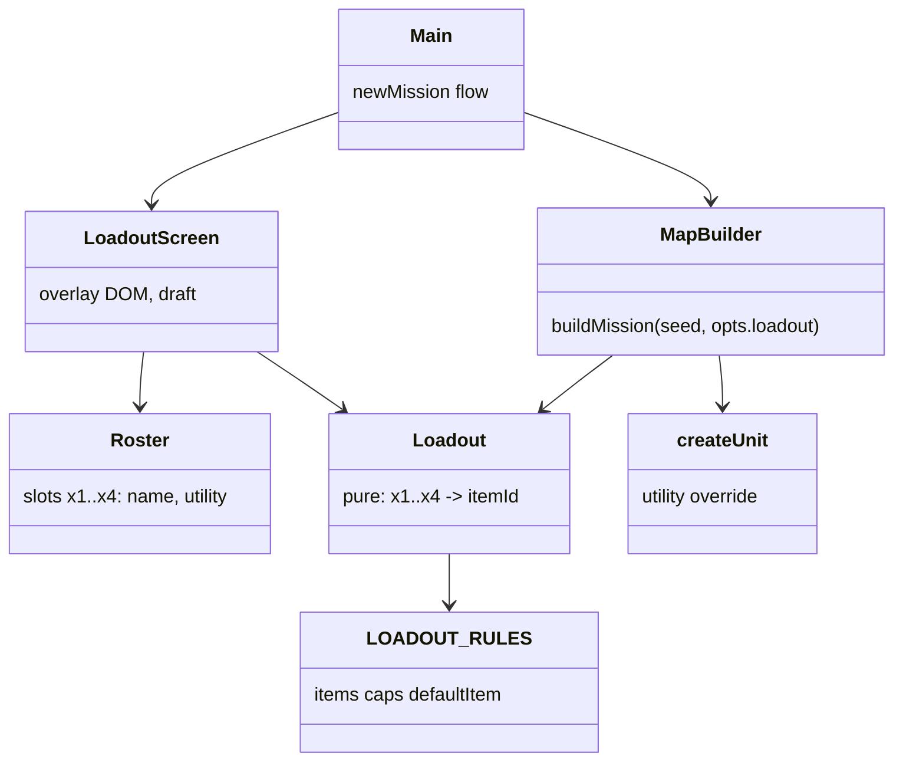
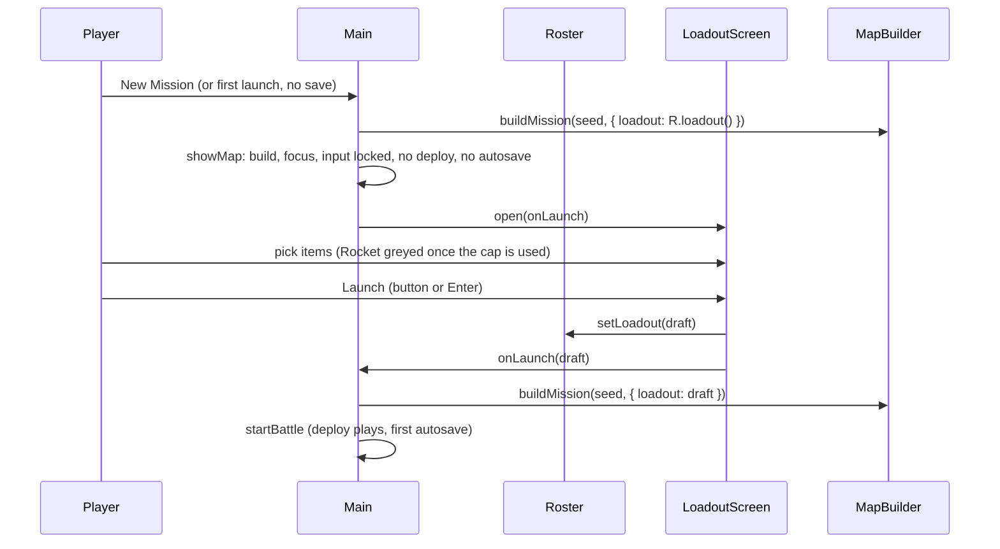
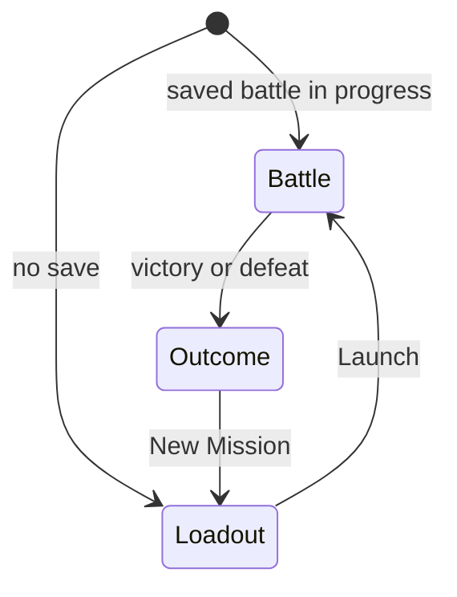

# Plan: Vigil Loadout Screen

| Field | Value |
|---|---|
| Status | Approved |
| Created | 2026-10-22 |
| Updated | 2026-10-22 |
| Proficiency | 5-7/10 |
| Engine | JavaScript (ES modules, no build step) + three.js, static page in `games/vigil/` |
| Revisions | 0 (latest: none) |
| Summary | A pre-mission loadout screen where each soldier picks one utility item (Frag Grenade or Rocket, one Rocket per squad), replacing the interim rule that the grenadier always carries the Rocket. |

## Revision Log

| ID | Date | Type | Change |
|---|---|---|---|
| (empty until first amendment) | | | |

---

## Overview

Plan 0001 Q3 added the Rocket as a squad utility item and parked it on the grenadier until a loadout screen exists (`js/data/classes.js`). Utility items are charge-limited abilities listed per class in `CLASSES[cls].utility`; `createUnit` adds their charges and `abilityIds` in `js/sim/abilities.js` lists them as usable. This plan moves utility from the class to the individual soldier and adds a screen to choose it before each mission.

Settled decisions:

- Slots: each soldier has 1 utility slot holding Frag Grenade or Rocket. At most 1 Rocket per squad. Class abilities (Launch Grenade and the rest) are unaffected.
- Timing: the screen opens on first launch with no battle in progress and after New Mission, prefilled with the last loadout. A saved battle in progress resumes without it.
- Classes stay fixed per slot (`DEFAULT_SQUAD`: Ranger, Sharpshooter, Grenadier, Specialist). The screen assigns items only.
- Storage: the plan 0003 `Roster` (`vigil.roster.v1`) owns the loadout, so each slot record is `{ name, utility }`.
- Default loadout: `x3` (Grenadier) takes the Rocket, the other three take a Frag Grenade.
- `BattleState` gains `unit.utility` and `STATE_VERSION` becomes 3. `load()` already rejects other versions, so a battle in progress when this ships is dropped once. `SAVE_KEY` stays `vigil.battle.v2`.
- The map behind the screen is the real mission map: the loadout uses no RNG, so `buildMission` with the same seed and the chosen loadout rebuilds the same map.
- Design gate (step 1): Layout A Briefing card (`docs/mockups/loadout-layout.html#a`), a centred card over the dimmed map with one row per soldier, two item buttons per row and Launch at the foot. Palette 2 Slot Tinted (`docs/mockups/loadout-palette.html`): the battle HUD tokens, the picked item bordered and tinted in the soldier's `--slot-N` colour, Launch in `--accent` #3FD0E8, disabled items #3A4A58 with a dashed border.

## Components



| Component | Responsibility | Owns |
|---|---|---|
| `RULES.loadout` (`js/data/rules.js`) | Which abilities are loadout items and their squad caps | `items`, `caps`, `defaultItem` |
| `Loadout` (`js/sim/loadout.js`, new, pure) | Default loadout, repair of invalid loadouts, cap checks | nothing; a loadout is a plain `{ x1..x4: itemId }` |
| `MapBuilder` + `createUnit` | Give each soldier their item as `unit.utility` and its charges | `unit.utility` in `BattleState` |
| `CLASSES` (`js/data/classes.js`) | Soldier classes lose `utility`; aliens are untouched | n/a |
| `Roster` (`js/view/roster.js`, plan 0003, extended) | Per-slot name and utility that survive new missions | `vigil.roster.v1` |
| `LoadoutScreen` (`js/view/loadout-screen.js`, new) | Overlay with one row per slot and a Launch button | the draft loadout until Launch |
| `Main` (`js/main.js`) | Routes boot and New Mission through the screen | n/a |

New files: `js/sim/loadout.js`, `js/view/loadout-screen.js`, `tests/loadout.test.mjs`. Everything else is a modification.

## Interactions

All calls are direct; one producer (the screen) and one consumer (main) need no event layer.

### New mission



### App modes



The screen has no cancel. Nothing is saved before Launch, so a reload while it is open shows it again.

## Component Stubs

### Rules (`js/data/rules.js`)

```js
loadout: { items: ['fragGrenade', 'rocket'], caps: { rocket: 1 }, defaultItem: 'fragGrenade' },
```

### Loadout (`js/sim/loadout.js`)

```js
export const SQUAD_SLOTS = Object.freeze(['x1', 'x2', 'x3', 'x4']);
export function defaultLoadout() {}                     // -> { x1: 'fragGrenade', x2: 'fragGrenade', x3: 'rocket', x4: 'fragGrenade' }
export function normalizeLoadout(loadout) {}            // -> new object; missing or unknown item -> defaultItem; past a cap, later slots in SQUAD_SLOTS order -> defaultItem
export function itemAllowed(loadout, slotId, itemId) {} // -> false when the other slots already hold caps[itemId] of itemId
```

### Unit creation (`js/sim/state.js`)

```js
export function createUnit(id, team, defId, def, tile, utility = def.utility ?? []) {} // stores unit.utility (a copy); charges from def.abilities + utility
```

`STATE_VERSION = 3`; the header comment documents `Unit.utility` as the soldier's utility ability ids.

### Abilities (`js/sim/abilities.js`)

`abilityIds(unit)` returns `[...new Set([...def.abilities, ...unit.utility])]`.

### MapBuilder (`js/sim/map-builder.js`)

```js
export function buildMission(seed, { plotSize = 3, pods = 3, squad = DEFAULT_SQUAD, enemyPool = DEFAULT_ENEMY_POOL, loadout = defaultLoadout() } = {}) {}
// normalizeLoadout(loadout), then createUnit(id, 'xcom', classId, CLASSES[classId], squadTiles[k], [loadout[id]])
```

### Roster (`js/view/roster.js`, extends the plan 0003 stub)

```js
// slots: { x1..x4: { name, utility } }; the constructor runs normalizeLoadout over the stored utilities
loadout() {}           // -> { x1..x4: itemId }, always normalized
setLoadout(loadout) {} // normalizes, saves, -> the stored loadout
```

### LoadoutScreen (`js/view/loadout-screen.js`)

```js
export class LoadoutScreen {
  constructor(root, roster) {}
  open(battle, onLaunch) {} // draft = roster.loadout(); a row per SQUAD_SLOTS entry: slot colour stripe, roster name, class name from battle.units, one button per RULES.loadout.items (disabled when !itemAllowed); Launch focused
  close() {}
}
```

Launch (button or Enter) calls `roster.setLoadout(draft)`, `close()`, then `onLaunch(draft)`. A disabled Rocket stays disabled; the player moves it by first setting the current holder to Frag Grenade.

### Main (`js/main.js`)

```js
function showMap(battle) {}  // build, syncUnits, setBounds, focus x1, input.lock(); split out of startBattle
function openLoadout(seed) {} // state = buildMission(seed, { loadout: roster.loadout() }); showMap(state); screen.open(state, (lo) => startBattle(buildMission(seed, { loadout: lo })))
```

Boot: a saved battle without an outcome goes to `startBattle(saved)`; anything else to `openLoadout(seed)`. `newMission` calls `clear()` and then `openLoadout(Date.now() >>> 0)`.

## Patterns

| Pattern | Where | Why |
|---|---|---|
| None | n/a | One screen, one consumer, direct calls cover it |

## Open Questions

- [ ] Item list growth: new utility items (smoke, medkit) only need an ABILITIES entry and a place in `RULES.loadout.items`. Revisit the one-slot rule if the list grows past what a row of buttons fits at phone width.

## Steps

Execution: Implement the steps in `#` order in one session, started on opus. Step 3 needs plan 0003 step 3 (`Roster`) built first.

| # | Step | Files | Depends on |
|---|---|---|---|
| 1 | UI design gate (global CLAUDE.md): 3 static grayscale layout mockups of the loadout overlay (slot rows, item picker, Launch); user picks. Then 3 palettes (Command Cyan plus 2 variants) on the chosen layout as labelled swatches; user picks. Record the picks in this plan. | scratch mockups, this plan | none |
| 2 | Sim loadout: `RULES.loadout`, `js/sim/loadout.js`, `createUnit` utility, `abilityIds` from `unit.utility`, `STATE_VERSION` 3, drop class `utility`, `buildMission({ loadout })`. Tests: defaults, normalize (unknown item, second Rocket repaired in slot order, missing slots), `itemAllowed`; default grenadier charges `{ launchGrenade: 2, rocket: 1 }`; a custom loadout moves the Rocket; a soldier without the Rocket gets "This unit cannot use that ability"; data test reads utility from `RULES.loadout.items`; state version. | `js/data/rules.js`, `js/data/classes.js`, `js/sim/loadout.js`, `js/sim/state.js`, `js/sim/abilities.js`, `js/sim/map-builder.js`, `tests/loadout.test.mjs`, `tests/map-builder.test.mjs`, `tests/abilities.test.mjs`, `tests/data.test.mjs`, `tests/save.test.mjs` | none |
| 3 | Roster `utility`, `loadout()` and `setLoadout()`, normalized on read. Tests: round trip, corrupt or over-cap stored utility repaired. | `js/view/roster.js`, `tests/roster.test.mjs` | plan 0003 step 3 |
| 4 | `LoadoutScreen` overlay, markup and CSS in the chosen layout and palette, Rocket greying, Enter to launch; the logo stays visible above it. | `js/view/loadout-screen.js`, `index.html`, `style.css` | 1, 3 |
| 5 | Main wiring: `showMap` split out of `startBattle`, `openLoadout`, boot branch, `newMission`. | `js/main.js` | 2, 4 |
| 6 | Verify: `node --test "games/vigil/tests/*.test.mjs"` and `node scripts/sync-logo.mjs --check` from the repo root, then a browser pass: first launch shows the screen over the map, a second Rocket is greyed, Launch deploys with the chosen items, a reload mid-battle resumes without the screen, New Mission reopens it prefilled, an old v2 battle save is dropped cleanly, no console errors. | none | all |

## Implementation Notes

- `abilityIds` is the only reader of `def.utility` besides `createUnit` and `tests/data.test.mjs:48`; grep for `utility` after step 2 to confirm none remain for soldiers.
- `hud.js` already shows charges from `unit.charges`, so the ability bar needs no change.
- `InputController` builds its first mode from the state in its constructor, so `main` must create the preview battle before the view exists on first launch, as it does today.
- Plan 0003's Roster stub owns `{ name }` only; its Overview line now points here.
- A roster saved before this plan has no `utility`; each slot then takes its `defaultLoadout()` item, so the grenadier keeps the Rocket.
- `LoadoutScreen` reads class names from the preview battle's units and reuses `esc` from `hud.js` (now exported). Enter in a text field (the rename input) is left to that field.
- `showMap` resets the turn banner (hidden for turn 0), concealment light and message, so nothing from the last mission shows behind the screen. `load()` removes a save from another version. The overlay sits at z-index 9 so the logo (10) stays above it.
- `openLoadout` takes `{ built }` so boot reuses the preview battle `main` built before the view existed.
