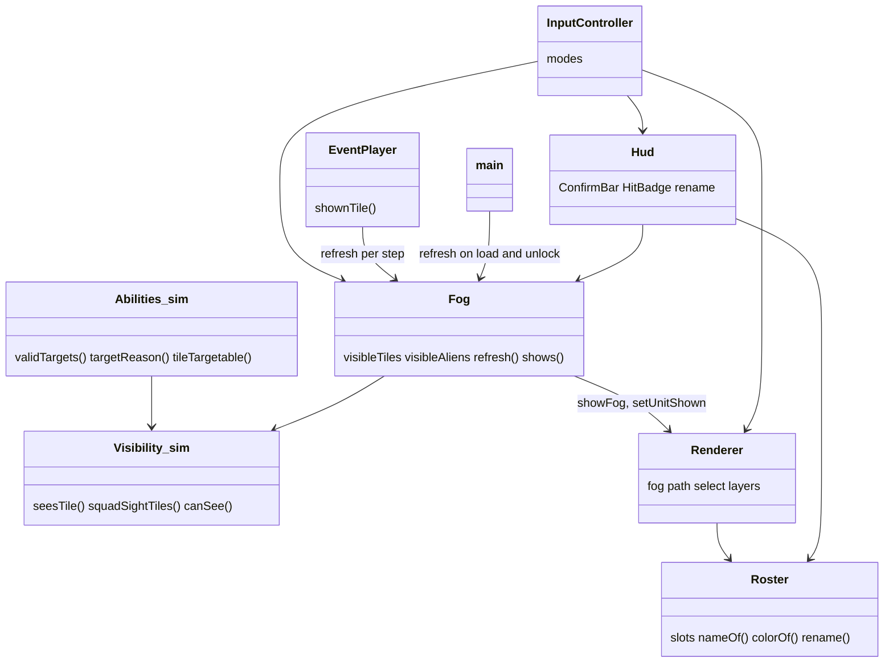
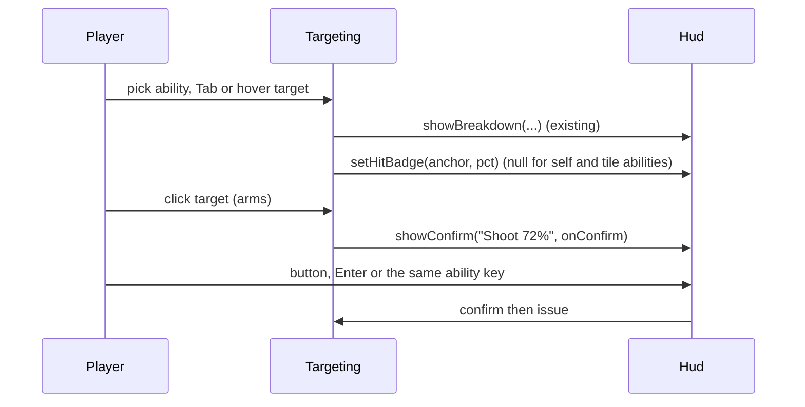
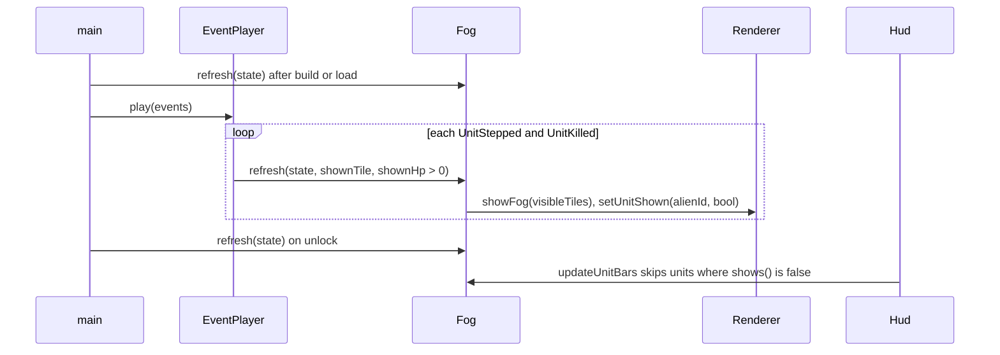
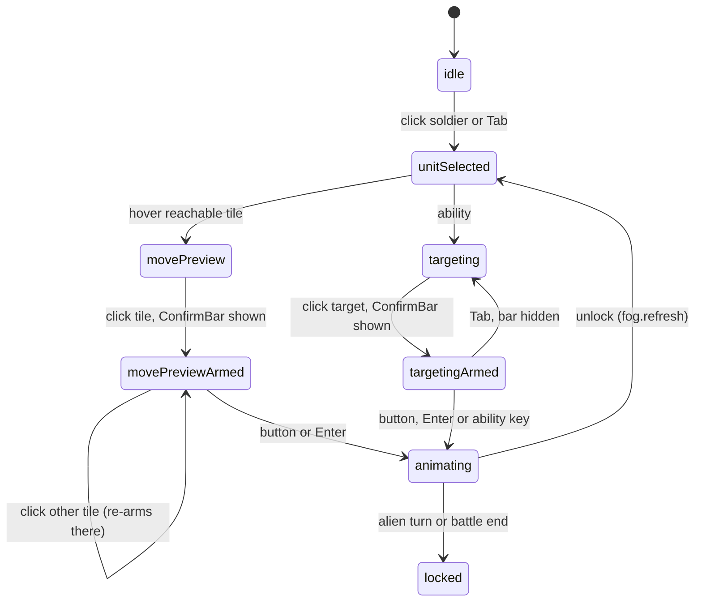

# Plan: Vigil Tactical UI

| Field | Value |
|---|---|
| Status | Approved |
| Created | 2026-10-22 |
| Updated | 2026-10-22 |
| Proficiency | 5-7/10 |
| Engine | JavaScript (ES modules, no build step) + three.js, static page in `games/vigil/` |
| Revisions | 0 (latest: none) |
| Summary | Tactical readability layer on top of plan 0001: ground path arrows, XCOM 2 style fog of war, a bottom confirm button, a hit chance badge, colour-coded renameable soldiers, a selected-soldier highlight, and a fix that stops blasts targeting tiles behind walls. |

## Revision Log

| ID | Date | Type | Change |
|---|---|---|---|
| (empty until first amendment) | | | |

---

## Overview

Plan 0001 built the battle and a working view, but the player cannot see where a move will walk, where squad sight ends, or which soldier is which at a glance, and the Layout C double-click confirm fires moves by accident. This plan adds those reads to the view layer and fixes one sim bug: `'tile'` targeting (Launch Grenade, Frag Grenade, Rocket) checked range only, so a grenade could land behind a wall the thrower cannot see. The sim change is limited to that fix plus one pure visibility helper; names and colours live in a view-only roster in localStorage, so `BattleState`, `STATE_VERSION` and the battle save stay as they are.

Decisions settled in the interview:

- Hit chance: one badge over the current target (unit or barrel) while an attack is armed or previewed. The rail breakdown keeps the full numbers.
- Blast LOS: a `'tile'` ability needs the tile in range and either seen by the thrower (sight radius plus LOS from its tile or a step-out tile, the barrel rule) or occupied by an enemy the thrower `canSee`. The second clause keeps grenades usable on an alien that is only visible through its own step-out peek.
- Fog of war: XCOM 2 style. Terrain and props are always drawn; tiles outside squad sight are dimmed; aliens no soldier `canSee` are hidden with their bars and are unpickable; red detection tiles show only around seen aliens. No memory of explored tiles.
- Confirm: a first click arms a move tile or target and a bottom-centre ConfirmBar appears (`Move`, `Dash`, `Shoot 72%`). The button, Enter, or the same ability key confirms. A second click on the armed tile only re-arms it. While armed, hover changes nothing, so the pointer can cross other tiles to reach the button (found in the step 8 browser pass); a click elsewhere re-arms, Tab or Esc disarms. This replaces the Layout C "click again to confirm" rule.
- Squad identity: each slot `x1` to `x4` has a fixed colour and an editable name, kept in `vigil.roster.v1` and carried across missions. Colour shows on the ground ring, path arrows, squad row and name plate. Plan 0002 (loadout) extends each slot record to `{ name, utility }` and adds `loadout()` and `setLoadout()`.
- Selection highlight: the selected soldier's ring grows and pulses in its slot colour; the squad row keeps its `.sel` look.
- UI gate (step 1): Layout B Compact pill (`docs/mockups/tactical-ui-layout.html#b`): a rounded ConfirmBar button flanked by key hints, a reticle around the target with the hit chance below it, a solid path line with an arrowhead, a squad row with a top band and slot number chip and the name in the slot colour, and a boxed rename input with a confirm tick. Palette 2 Field Muted (`docs/mockups/tactical-ui-palette.html#p2`) on the Command Cyan base: slots `#8FB8DE`, `#C9A0DC`, `#9CCB9A`, `#E0B27A`; badge ring and fill `#E6EEF4`, badge text `#0B1118`. Default names are random picks from a surname pool, and a blank rename draws a new one.

## Architecture



New files: `js/view/fog.js`, `js/view/roster.js`, `tests/roster.test.mjs`. Everything else is a modification.

## Key Flows

### Move with path arrows and the ConfirmBar

```mermaid
sequenceDiagram
  participant P as Player
  participant I as MovePreview
  participant R as Renderer
  participant H as Hud
  P->>I: hover tile
  I->>R: showPath(pathTo(reach, tile), slotColor)
  P->>I: click tile (arms)
  I->>H: showConfirm("Move" or "Dash", onConfirm)
  P->>H: click button (or Enter)
  H->>I: onConfirm
  I->>I: issue(move) then validate then main
  Note over I: while armed, hover changes nothing so the pointer can reach the bar; clicking another tile re-arms there, Esc disarms
```

### Attack with the hit badge



### Fog during playback



The sim state is final before playback starts, so the fog reads the tile each unit is drawn on (`shownTile`) and its drawn HP, the same way `_holdHp` already handles bars.

### Input mode (InputController)



Armed is the existing `data.armed` field, drawn here as its own state. Every `setMode` exit hides the ConfirmBar, clears the hit badge and clears the path.

## Components

### Visibility (`js/sim/visibility.js`)
Responsibility: adds tile sight helpers for blast targeting and fog.
Owns: nothing.

Stub:
```js
// Sight radius from fromTile, LOS from it or one of its step-out tiles; the target tile's own prop never blocks. Moved here from abilities.js.
export function seesTile(state, unit, tile, fromTile = unit.tile) {}
// -> Set<tile> any living team member sees by seesTile. tileOf(unit) gives drawn positions during playback. Fog dimming only; unit sight stays canSee.
export function squadSightTiles(state, team, tileOf = (u) => u.tile) {}
```

### AbilitySystem (`js/sim/abilities.js`)
Responsibility: `'tile'` targeting stops ignoring walls.
Owns: nothing new.

Stub:
```js
// In range AND (seesTile(unit, tile) OR an enemy the unit canSee stands on tile). Used by validTargets and targetReason.
function tileTargetable(state, unit, def, tile) {}
```
`targetReason` returns `'No line of sight'` when the tile is in range but not targetable. The `'prop'` case switches to the moved `seesTile`.

### Fog (`js/view/fog.js`)
Responsibility: what the player currently sees, shared by the renderer, HUD bars, input and event player.
Owns: `visibleTiles`, `visibleAliens`.

Stub:
```js
export class Fog {
  visibleTiles = new Set();  // tiles from squadSightTiles('xcom')
  visibleAliens = new Set(); // living aliens some living soldier canSee, with both at their drawn tiles; peeking aliens count
  constructor({ renderer }) {}
  // Recomputes both sets, then renderer.showFog(visibleTiles) and setUnitShown for every alien. tileOf and alive come from EventPlayer during playback.
  refresh(state, tileOf = (u) => u.tile, alive = (u) => u.hp > 0) {}
  shows(unit) {} // -> true for soldiers, visibleAliens.has(id) for aliens
}
```

### Roster (`js/view/roster.js`)
Responsibility: slot names and colours that survive new missions.
Owns: `slots: { x1..x4: { name } }` in `vigil.roster.v1`.

Stub:
```js
export const ROSTER_KEY = 'vigil.roster.v1';
export class Roster {
  constructor(storage = globalThis.localStorage) {} // missing, private mode or corrupt JSON -> defaults; every access in try/catch like save.js
  nameOf(unit) {}        // -> slot name for soldiers, class name (unitDef(unit).name) for aliens
  colorOf(unit) {}       // -> the --slot-N colour read from CSS for x1..x4, null for aliens
  rename(unitId, text) {} // trims, caps at 16 chars, blank -> default; saves; -> the stored name
}
```
Default names are random picks from `NAME_POOL` (no two slots share one), saved on first load; a blank rename draws a new unused name. Slot colours are CSS tokens `--slot-1` to `--slot-4` in `style.css`, read the same way as `readPalette()`.

### Renderer (`js/view/renderer.js`)
Responsibility: new overlay layers and per-unit looks.
Owns: `fog`, `path` and `select` layers; per-soldier ring materials.

Stub:
```js
showPath(tiles, color) {}       // chevrons on the ground between consecutive path tiles, an end ring on the destination; [] clears
showFog(visibleTiles) {}        // dim quads on every tile not in the set; the fog layer is skipped by clearOverlays
setUnitShown(unitId, shown) {}  // object.visible = shown && alive; hidden aliens drop out of pickableUnits
setUnitColor(unitId, color) {}  // per-soldier ring material, called after build
setSelected(unitId) {}          // null clears; larger ring in the slot colour, pulsed in render()
showDetection(state, alienIds) {} // red tiles only around the given aliens
```
`syncUnits` keeps setting `visible = hp > 0`, so `main` and `EventPlayer` call `fog.refresh` after any `syncUnits` call.

### Hud (`js/view/hud.js`)
Responsibility: ConfirmBar, hit badge, rename, roster names and colours, fog-aware bars.
Owns: DOM for the bar, badge and rename field.

Stub:
```js
constructor(root, roster) {}
showConfirm(label, onConfirm) {} // bottom-centre bar inside .viewport; buttons never take focus (existing mousedown guard)
hideConfirm() {}
setHitBadge(anchor, pct) {}      // anchor { unitId } or { tile }, null hides; positioned in the updateUnitBars pass
updateUnitBars(state, project, hpOf, shows = () => true) {} // skips units where shows(unit) is false
onRename(callback) {}            // name plate click swaps in an <input>; Enter or blur commits through callback(unitId, text), Esc cancels
```
`showUnit` and `showSquad` use `roster.nameOf` and a `--slot` colour stripe. `updateUnitBars` needs a tile projection for barrel badges: `EventPlayer.projectTile(tile)` beside the existing `project(unitId)`.

### InputController (`js/view/input.js`)
Responsibility: wires the new reads into the existing modes.
Owns: nothing new (`data.armed` already exists).

Changes:
- `MovePreview.show` calls `showPath(pathTo(ic.reach, data.tile), roster.colorOf(selected))`. Arming calls `showConfirm(apCost === 1 ? 'Move' : 'Dash', ...)`. A click on the armed tile no longer confirms.
- `Targeting.show` calls `setHitBadge(anchor, hit)` from the same `compute` result the breakdown uses (100 for guaranteed hits, null for self and tile abilities). Arming calls `showConfirm(`${name} ${pct}%`, ...)`; tile abilities show the name only.
- `setMode` calls `hideConfirm()`, `setHitBadge(null)` and `showPath([])` before entering the next mode.
- `select` calls `renderer.setSelected(id)`; `Idle.enter` calls `setSelected(null)`.
- `baseOverlays` passes `fog.visibleAliens` to `showDetection`.
- `_keyDown` ignores game keys while an `<input>` has focus.
- Header comment and `CONFIRM_NOTE` change to the ConfirmBar rule.

### EventPlayer (`js/view/event-player.js`)
Responsibility: keeps the fog in step with playback.
Owns: `_tiles` (unit id to drawn tile while playing).

Stub:
```js
shownTile(unit) {}   // -> drawn tile during playback, else unit.tile
projectTile(tile) {} // -> screen px above the tile, for the barrel hit badge
_holdTiles(events) {} // each mover's first UnitStepped.from, like _holdHp
```
After each `UnitStepped` and `UnitKilled` handler it calls `fog.refresh(state, (u) => this.shownTile(u), (u) => this.shownHp(u) > 0)`, so an alien killed later in the batch stays drawn until its death plays. `_unseenStep` is unchanged.

### main.js
Creates `Roster` and `Fog`, passes the roster to `Renderer` colours and `Hud`, calls `fog.refresh(state)` after `build`/load and in `unlock`, and passes `(u) => fog.shows(u)` to the per-frame `updateUnitBars`.

## Patterns Applied

| Pattern | Where | Why |
|---|---|---|
| Shared read model | `Fog` read by Renderer, Hud, InputController, EventPlayer | one visibility computation per step instead of four |

## Open Questions

- [ ] Rename trigger on touch: a tap on the name plate works on desktop and mobile, but the plate also sits in the rail that collapses at phone width. Revisit if the mobile layout changes.
- [x] Fog cost per refresh is about 576 tiles x 4 soldiers x up to 5 origins of `hasLosTiles`. Measured in step 8: about 1 ms per refresh in the browser, so no cache.

## Steps

Execution: Implement the steps in `#` order in one session, started on opus.

| # | Step | Files | Depends on |
|---|---|---|---|
| 1 | UI design gate (global CLAUDE.md): 3 static grayscale layout mockups covering the ConfirmBar, hit badge, rename field and squad row stripe; user picks. Then 3 palettes with the four slot colours and badge colours as labelled swatches on the chosen layout; user picks. Record the picks in this plan. | scratch mockups, this plan | none |
| 2 | Blast LOS fix: move `seesTile` to visibility with `fromTile`, add `squadSightTiles` and `tileTargetable`, `'No line of sight'` reason. Tests: grenade at a tile behind a wall rejected, rocket same, peeking enemy behind full cover still targetable, open tile in sight allowed, `squadSightTiles` matches `seesTile` per tile. | `js/sim/visibility.js`, `js/sim/abilities.js`, `tests/abilities.test.mjs`, `tests/visibility.test.mjs` | none |
| 3 | `Roster` module. Tests: defaults, rename trims and caps at 16, blank falls back, corrupt JSON and throwing storage fall back to defaults, aliens get class names and null colour. | `js/view/roster.js`, `tests/roster.test.mjs` | none |
| 4 | Fog: `Fog` class, `Renderer.showFog`, `setUnitShown`, `showDetection(state, alienIds)`, `clearOverlays` skips fog; EventPlayer `_holdTiles`, `shownTile`, refresh after step and kill handlers; main wiring on build, load and unlock; bars skip hidden aliens. | `js/view/fog.js`, `js/view/renderer.js`, `js/view/event-player.js`, `js/main.js`, `js/view/hud.js` | 2 |
| 5 | Renderer path chevrons, `setSelected` pulsing ring, `setUnitColor` per soldier from the roster. | `js/view/renderer.js`, `js/main.js` | 1, 3 |
| 6 | Hud ConfirmBar, hit badge (with `EventPlayer.projectTile`), inline rename, roster names and colour stripes, CSS tokens `--slot-1..4`; bar sits above `--logo-floor`. | `js/view/hud.js`, `js/view/event-player.js`, `style.css`, `index.html` | 1, 3, 4 |
| 7 | Input modes: arming shows the ConfirmBar, second click only re-arms, path, hit badge, selection highlight, detection from `fog.visibleAliens`, key guard for the rename input, header comment and `CONFIRM_NOTE`. Update plan 0001's Input mode note with a pointer here. | `js/view/input.js`, `docs/plans/0001-tactical-layer.md` | 5, 6 |
| 8 | Verify: `node --test "games/vigil/tests/*.test.mjs"` and `node scripts/sync-logo.mjs --check` from the repo root, then a browser pass: grenade and rocket refuse a tile behind a wall, path arrows follow the route, ConfirmBar moves and shoots, a double click no longer fires, fog dims and hides aliens during an alien turn, detection tiles only around seen aliens, rename survives a new mission, no console errors. | none | all |

## Implementation Notes

- The fog must never leak positions: check `showDetection`, the HP bars, the objective panel's alien count (allowed, XCOM 2 shows it), the camera focus in `_onUnitStepped` (already skipped for unseen steps) and pod reveal flyovers.
- `pickableUnits` already filters on `visible`, so hidden aliens cannot be clicked. Tab target cycling uses `squadVisible`, which agrees with `visibleAliens` outside playback.
- `pathTo(reachMap, dest)` in `pathfinder.js` returns the tile list from the `prev` chain without the start tile, so prepend the soldier's tile before drawing.
- The ConfirmBar sits inside `.viewport`, left of the rail, so the logo rule in the repo CLAUDE.md (`--logo-floor`) only applies if the bar spans the window bottom.
- Rename input: `maxlength="16"`, plain text through `esc()` everywhere it is rendered.
