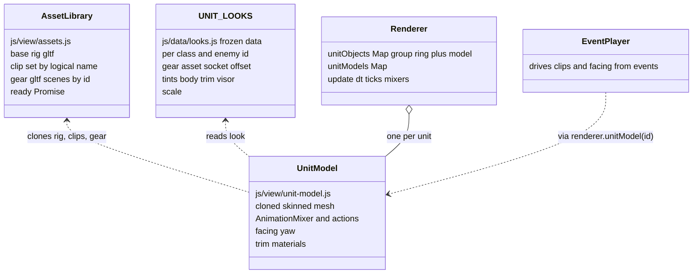
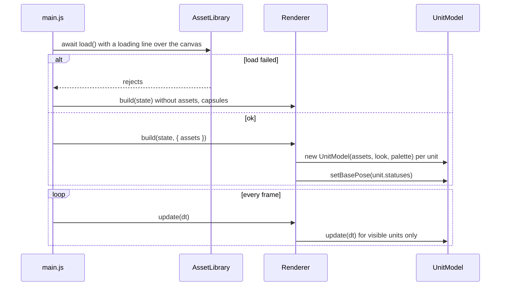
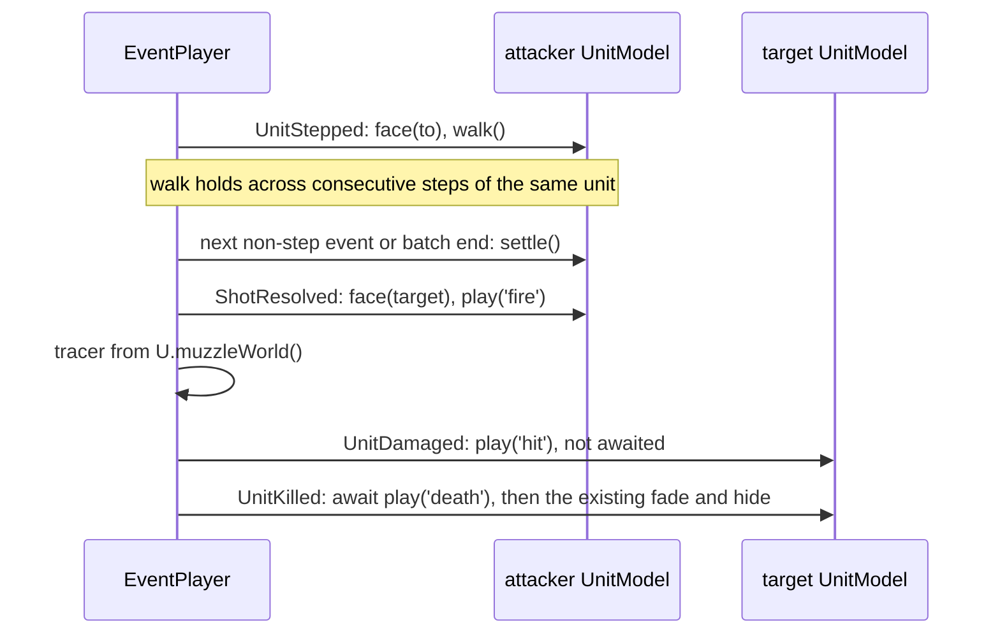
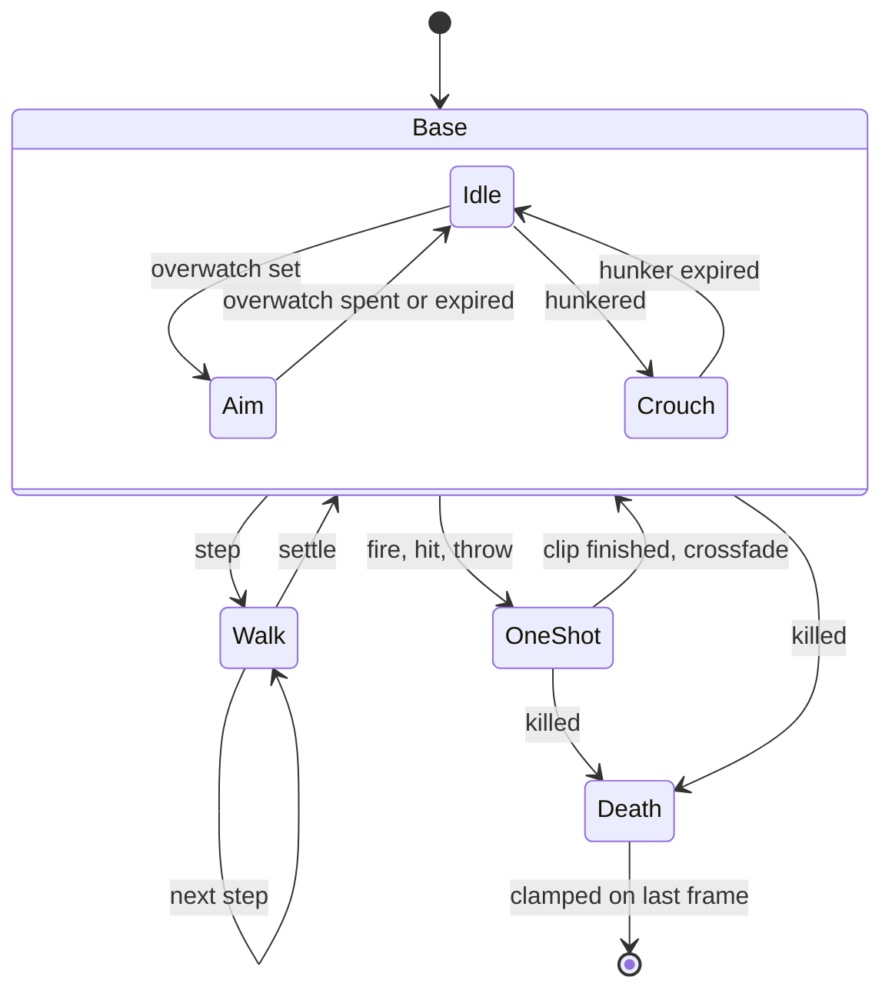

# Plan: Vigil Character Visuals

| Field | Value |
|---|---|
| Status | Implemented |
| Created | 2026-10-22 |
| Updated | 2026-10-23 |
| Proficiency | 5-7/10 |
| Engine | JavaScript (ES modules, no build step) + three.js r160, static page in `games/vigil/` |
| Revisions | 8 (latest: U-008) |
| Summary | Replace the capsule-plus-ring unit look with CC0 rigged glTF characters on one shared skeleton (mannequins for the squad, skeletons for enemies) that wear per-class and per-enemy gear, faces its moves and targets, and plays clips (idle, walk, aim, fire, hit, crouch, throw, death) driven by battle events. |

## Revision Log

| ID | Date | Type | Change |
|---|---|---|---|
| U-008 | 2026-10-23 | Update | Follow-ups: ability blasts name their source (`Explosion.sourceId`, `abilityId`), so the thrower faces the blast and plays `throw` (frag grenade) or `fire` (launcher, rocket) during the camera ease; `tests/event-player.test.mjs` covers the step 7 wiring; the mannequin is confirmed as `Mannequin_Medium.glb` from KayKit Character Animations (CC0) |
| U-007 | 2026-10-22 | Update | Step 8 done: tests and logo check pass, walk, fire, melee, hit, death, overwatch and hunker poses, reload resume, skip, fog-hidden aliens, New Mission rebuild and the capsule fallback verified in the browser; squad slot colours read apart at 1400x850 |
| U-006 | 2026-10-22 | Fix | Step 7 done: the shot clip starts with the camera ease so the weapon is up when the tracer leaves the muzzle; slash, Stun Lance and the pistol play their own clips (`SHOT_CLIPS`); death waits `DEATH_CLIP` on the tween clock and then `finish()`, since clips advance only in the frame loop, which stops in a background tab; clips run at the player speed; only capsules hop; poses refresh from the state after every batch |
| U-005 | 2026-10-22 | Improvement | Step 6 done: with models the capsule stays as an invisible pick hitbox and model meshes skip raycasts, so hover picking never walks skinned meshes; `#loading` line in `index.html` |
| U-004 | 2026-10-22 | Fix | Step 5 done: in the aim and fire clips the hand slot's +x points at the target, so code guns and the crossbow turn a quarter onto it; trim maps are greyscaled at load so the slot tint reads cleanly over the mannequin's colour atlas; missing clips fall back (`FALLBACK` in `unit-model.js`) |
| U-003 | 2026-10-22 | Fix | Steps 2 to 4 done: `SOCKETS` use three's dotless bone names, `MODEL_FILES` moved to `looks.js`, `AssetLibrary.clip(name, model)` fits clips to each model's bones |
| U-002 | 2026-10-22 | Update | Step 1 done: code-built soldier guns, enemy mapping, clip and socket names, `MODEL_FILES` per character, 2.4 MB of assets written |
| U-001 | 2026-10-22 | Update | Assets switched to KayKit `Rig_Medium`: mannequin for the squad, Skeletons 1.1 for enemies, Character Animations clips; Open Questions updated from intake |

---

## Overview

Every unit is a shared `CapsuleGeometry` body plus a ground ring (`Renderer._addUnit`, `js/view/renderer.js`), so classes and enemies differ only by ring colour and the HUD. This plan gives each unit a readable model: one rigged humanoid shared by every soldier and alien, dressed in gear mounted on bone sockets, tinted per team and per roster slot, and animated by the events `EventPlayer` already plays. Everything lives in the view layer; the sim, saves and seeded determinism are untouched.

Settled decisions:

- Models are glTF (`.glb`), loaded with `GLTFLoader` vendored from three r160 beside `vendor/three.module.min.js`. A procedural primitive style was mocked (`docs/mockups/characters-style.html`, styles A Chunky, B Slim, C Faceted) and rejected.
- Assets (step 1 intake, source folder `C:/Users/alex_/Desktop/Characters/`): every model and clip uses the KayKit `Rig_Medium` skeleton (bones `root`, `hips`, `spine`, `chest`, `head`, `upperarm`/`lowerarm`/`wrist`/`hand` `.l`/`.r`, `upperleg`/`lowerleg`/`foot`/`toes` `.l`/`.r`), so models and clips share one rig with no retargeting.
  - Soldiers use `Mannequin_Medium.glb` (KayKit Character Animations, 21 joints, one `Character_Material` with `mannequin_texture.png`).
  - Enemies use the KayKit Skeletons 1.1 FREE characters (`Skeleton_Warrior`, `Skeleton_Minion`, `Skeleton_Rogue`, `Skeleton_Mage`; 23 joints adding `handslot.l`/`handslot.r`; materials `skeleton` and `Glow`). Their own weapons (`Skeleton_Blade`, `Skeleton_Crossbow`, `Skeleton_Staff` and others) are available as gear.
  - Clips come from the KayKit Character Animations `Rig_Medium` files (General, MovementBasic, MovementAdvanced, CombatRanged, CombatMelee, Special and others); the skeleton pack's two clip files are byte-identical copies of the same set.
  - Licences: KayKit Skeletons 1.1 is CC0 per its `License.txt`. KayKit Character Animations is CC0 per its itch.io page; the mannequin ships in that pack (confirmed with the user, U-008).
- Identity comes from the base model (mannequin for the squad, one skeleton variant per enemy type), gear on hand and back bones, and material tints. A new class is new data in `UNIT_LOOKS`.
- Motion: units face their move direction and their target; clips play through `THREE.AnimationMixer`. Base pose comes from statuses (overwatch aims, hunkered crouches), so a resumed battle shows the right pose.
- Roster slot colour stays on the ground ring (which also carries selection) and also tints the model's trim material.
- If loading fails, the game falls back to today's capsules and keeps running.
- No palette gate: tints reuse the battle HUD palette already chosen (`xcom`, `alien`, roster slot colours).

## Architecture



The group `renderer.unitObject(id)` returns keeps its role (position, visibility, fog); the model is a child of it beside the ring, so every existing `unitObject` caller in `event-player.js` keeps working.

## Key Flows

### Boot and frame loop



### Event playback



### UnitModel clip state



## Components

### UNIT_LOOKS (`js/data/looks.js`)

Responsibility: what each unit type looks like, and the one place that maps logical clip, socket and material names to the asset's own names.
Owns: `CLIPS`, `SOCKETS`, `MATERIAL_ROLES`, `UNIT_LOOKS`.
Pattern: none (frozen data, same style as `classes.js` and `enemies.js`).

Stub:

```js
// Logical clip and socket names map to the asset's own names here, so swapping packs edits only this file.
// Written in step 1 (js/data/looks.js): CLIPS (idle, walk, aim, fire, pistol, reload, cast, melee, stab, hit, crouch, throw, death),
// SOCKETS (handR, handL, slotR, chest, head, hips; values are three.js bone names, which GLTFLoader writes without dots: handr),
// MATERIAL_ROLES (Character_Material: trim, skeleton: body, Glow: visor).
// Step 3 also put MODEL_FILES and CODE_GEAR here (data, so node tests check them without loading three), plus clipName(look, logical).
// Shape: { model, scale, clips?: { [logical]: assetClip }, tints: { body?, trim?, visor? },
//          gear: [{ asset | mesh, socket, offset?: [x, y, z], rotation?: [x, y, z], muzzle?: true }] }
// model is a MODEL_FILES.characters key; asset is a MODEL_FILES.gear key (glb); mesh is a code-built gun (rifle, shotgun, sniper, cannon, pistol, sword).
// Skeleton looks override clips.idle and clips.walk with Skeletons_Idle and Skeletons_Walking.
// tints name renderer palette keys; a soldier's trim is replaced by its roster slot colour.
export const UNIT_LOOKS = deepFreeze({ ranger: {}, sharpshooter: {}, grenadier: {}, specialist: {}, trooper: {}, officer: {}, stunLancer: {}, sectoid: {} });
export function lookFor(defId) {} // UNIT_LOOKS[defId] ?? UNIT_LOOKS.trooper
```

### AssetLibrary (`js/view/assets.js`)

Responsibility: load every `.glb` once and hand out clones.
Owns: the parsed rig, clips by logical name, gear scenes by id.

Methods:
- `load()` -> `Promise<void>`, loads every file in parallel; rejects if any fail; returns the same promise on repeat calls
- `cloneRig(model)` -> `Object3D`, skinned clone of a `MODEL_FILES.characters` model via `SkeletonUtils.clone`, materials cloned per call so tints stay per unit
- `cloneGear(id)` -> `Object3D`, throws on an unknown id (a data bug, caught by a test)
- `clip(name, model)` -> `AnimationClip | null`, an asset clip name (callers resolve logical names with `clipName`), fitted to the model's bones: the mannequin lacks the `handslot` bones and three warns for every track with no target, so each model gets a cached copy holding only its own tracks
- `dispose()`

Stub:

```js
// MODEL_FILES lives in js/data/looks.js; code-built guns are made by UnitModel, not the library.
export class AssetLibrary {
  load() {}              // -> Promise<void>; idempotent
  cloneRig(model) {}     // -> Object3D with its own tintable materials
  cloneGear(id) {}       // -> Object3D; throws on unknown id
  clip(name, model) {}   // -> AnimationClip fitted to the model's bones, or null
  dispose() {}           // frees geometry, textures and materials the library owns
}
```

### UnitModel (`js/view/unit-model.js`)

Responsibility: one unit's visible body, its clips and its facing.
Owns: the cloned rig and gear, an `AnimationMixer`, one action per clip, the base pose, the active walk or one-shot, current and target yaw, per-unit trim materials.
Pattern: none. A three-value base pose plus one walk flag and one one-shot slot is smaller than a State-pattern hierarchy.

Methods:
- `constructor(assets, look, palette)`, clones the rig, mounts gear on `SOCKETS` bones, applies tints and bone scale, builds the mixer and actions, plays idle
- `root`, the `Object3D` added to the unit group
- `setTrim(color)`, roster slot colour onto the `trim` materials
- `setBasePose(statuses)`, `aim` for overwatch, `crouch` for hunkered, else `idle`; crossfades unless walking or a one-shot is running, which return to the new base when they end
- `face(worldPoint, { instant })`, yaw toward a point on the xz plane; instant snaps
- `walk()`, loop walk; idempotent
- `settle()`, walk back to the base pose; no-op when not walking
- `play(name)` -> `Promise`, one-shot (`fire`, `hit`, `throw`, `death`) resolved on the mixer's `finished`; death clamps on its last frame and blocks later clips; a new one-shot resolves the one it replaces
- `finish()`, skip: jumps any one-shot to its end and resolves it, snaps facing
- `muzzleWorld(target)` -> `Vector3`, world position of the gear marked `muzzle`, else chest height
- `update(dt)`, mixer and facing ease (about 0.15 s)
- `dispose()`, cloned materials only; geometry is shared with the library

Stub:

```js
export class UnitModel {
  constructor(assets, look, palette) {}
  root;                          // Object3D child of the renderer's unit group
  setTrim(color) {}              // slot colour onto trim materials
  setBasePose(statuses) {}       // 'idle' | 'aim' | 'crouch' from statuses
  face(worldPoint, { instant = false } = {}) {}
  walk() {}                      // idempotent loop
  settle() {}                    // walk -> base pose
  play(name) {}                  // -> Promise; one-shot or clamped death
  finish() {}                    // skip to end of any one-shot and facing
  muzzleWorld(target) {}         // -> Vector3
  update(dt) {}
  dispose() {}
}
```

### Renderer changes (`js/view/renderer.js`)

- `build(battle, { assets } = {})`: with `assets`, `_addUnit` adds a `UnitModel` beside the ring and stores it in `unitModels`; without, it builds today's capsule.
- `unitModel(id)` -> `UnitModel | null`.
- `update(dt)` ticks the models whose unit group is visible.
- `setUnitColor` also calls `model.setTrim(color)`.
- `syncUnits` calls `model.setBasePose(unit.statuses)`.
- Rebuild and dispose free every `UnitModel`.

### EventPlayer changes (`js/view/event-player.js`)

- `_onUnitStepped`: `face(to)` (instant when the step is unseen or skipping) and `walk()`; the unit joins a walking set.
- `play()`: before any event that is not a `UnitStepped` of the same unit, and at batch end, `settle()` every walking unit.
- `_onShotResolved`: `face(target)`, `play('fire')` (or the ability's clip in `SHOT_CLIPS`) during the camera ease, tracer starts at `muzzleWorld(target)` instead of the fixed `MUZZLE` height. Hidden shooters stay hidden and play nothing.
- `_onUnitDamaged`: `play('hit')`, not awaited.
- `_onUnitKilled`: `play('death')`, a `DEATH_CLIP` wait on the tween clock, `finish()`, then the existing material fade and hide.
- `_onStatusApplied`, `_onStatusExpired`, `_onOverwatchSet`: refresh the base pose from the state.
- `skip()`: also `finish()` on every model.
- Every model call is a no-op when `unitModel(id)` is null, which covers the capsule fallback.

### main.js changes

- `const assets = new AssetLibrary()` and `await assets.load()` (top-level await) before `buildView`, with a `Loading` line over the canvas; a rejection logs a warning and builds capsules.
- `buildView` passes `assets` when loaded.
- `frame` calls `renderer.update(dt)`.

## Patterns Applied

| Pattern | Where | Why |
|---|---|---|
| Flyweight | `AssetLibrary` shares geometry, skeleton data and clips across `UnitModel` clones | eight units load one rig and one clip set |
| Data-driven looks | `UNIT_LOOKS` | a new class or enemy is data, not code |

## Open Questions

- [x] Base models: glTF is available for every model and clip set (resolved at intake, see Overview).
- [x] Clips: aim, fire, reload, crouch, throw and hit all exist (`Ranged_2H_Aiming`, `Ranged_2H_Shoot`, `Ranged_2H_Reload`, `Crouching`, `Throw`, `Hit_A`), plus skeleton-specific `Skeletons_Idle`, `Skeletons_Walking`, `Skeletons_Death` and melee attacks for Slash and Stun Lance.
- [x] Soldier weapons: code-built box and cylinder guns (shotgun, sniper, cannon, rifle, pistol, sword), mounted on `hand.r` since the mannequin has no `handslot` bones.
- [x] Enemy mapping (role match): trooper is `Skeleton_Minion` with the crossbow, officer is `Skeleton_Warrior` with the crossbow, stunLancer is `Skeleton_Rogue` with the blade, sectoid is `Skeleton_Mage` with the staff.
- [x] `Crouching` and every other kept clip plays in place (root translation stays at the origin), so the hunker pose loops it. `Skeletons_Death` moves the root about 0.7 tiles back, so every unit dies with `Death_A`.
- [x] Download budget: `assets/models/` is 2.4 MB (clips 610 KB, five characters 1.6 MB, three gear pieces 170 KB).
- [x] The mannequin's single textured material carries the roster slot colour over a greyscale copy of its map (step 5); the four slot colours read apart in the step 5 harness and at the game's default zoom (step 8).

## Steps

Execution: Implement the steps in `#` order in one session, started on opus.

| # | Step | Files | Depends on |
|---|---|---|---|
| 1 | Asset intake: the user downloads the CC0 packs, Claude confirms each licence on its pack page, inspects clip, bone and material names, trims to the eight clips and one body with `npx @gltf-transform/cli`, writes `clips.glb`, the character `.glb` files and `gear/*.glb`, adds `assets/models/CREDITS.md`, and fills in `CLIPS`, `SOCKETS` and `MATERIAL_ROLES`. Resolve the Open Questions here. | `assets/models/**`, `js/data/looks.js` (names only) | none |
| 2 | Vendor `GLTFLoader`, `SkeletonUtils` and `BufferGeometryUtils` from three r160 with their `'three'` imports pointed at `vendor/three.module.min.js`. | `vendor/*` | none |
| 3 | `UNIT_LOOKS` and `lookFor` for all 8 unit types. Tests: every class and enemy id has a look, every gear `asset` is in `MODEL_FILES.gear`, every `socket` is a `SOCKETS` key, `lookFor` falls back to trooper. | `js/data/looks.js`, `tests/looks.test.mjs` | 1 |
| 4 | `AssetLibrary` from its stub. | `js/view/assets.js` | 2 |
| 5 | `UnitModel`: gear mounting, tints and bone scale, base pose, walk and one-shot slots, crossfades, facing ease, `finish`, `muzzleWorld`. | `js/view/unit-model.js` | 3, 4 |
| 6 | Renderer integration (model beside the ring, `update`, `unitModel`, trim, base pose in `syncUnits`, dispose, capsule fallback) and the `main.js` boot (await load, loading line, `renderer.update` in `frame`). | `js/view/renderer.js`, `js/main.js`, `style.css` | 5 |
| 7 | EventPlayer wiring: face and walk on steps, settle before other events and at batch end, fire with the muzzle tracer, hit, awaited death then fade, status base poses, skip calls `finish`. | `js/view/event-player.js` | 6 |
| 8 | Verify: `node --test "games/vigil/tests/*.test.mjs"` and `node scripts/sync-logo.mjs --check` from the repo root, then a browser pass: all 8 unit types read apart at the default zoom, walk, fire, hit, death, overwatch and hunker poses, a reload resumes with the right poses, Space skips cleanly, fog-hidden units stay hidden, New Mission rebuilds models, a missing `.glb` falls back to capsules, `assets/models/` size within budget, no console errors. | none | all |

## Implementation Notes

- `SkeletonUtils.clone` is required for skinned meshes; `Object3D.clone` shares the skeleton and every unit would pose together.
- Clone materials per unit only for the roles that get tinted (`body`, `trim`); share the rest.
- Keep the model inside the existing 1.0 unit body height (`UNIT_BODY`, `RULES.bodyHeight`) so cover, the HUD head anchor (`HEAD`) and line-of-sight visuals still match.
- The death fade in `_onUnitKilled` clones materials and swaps them back; with skinned meshes it must traverse every `SkinnedMesh` and gear mesh the same way.
- A mission switch (`missionId` bump in `main.js`) can land mid-clip: `Renderer.build` disposes the old models, so any pending `play()` promise must resolve on dispose to free `EventPlayer`.
- Mixers of hidden units skip `update`, so a unit revealed mid-clip resumes from where its clip paused; acceptable for aliens walking into view.
- The Pages build deploys only `games/vigil/`, so every asset path is relative to it.
